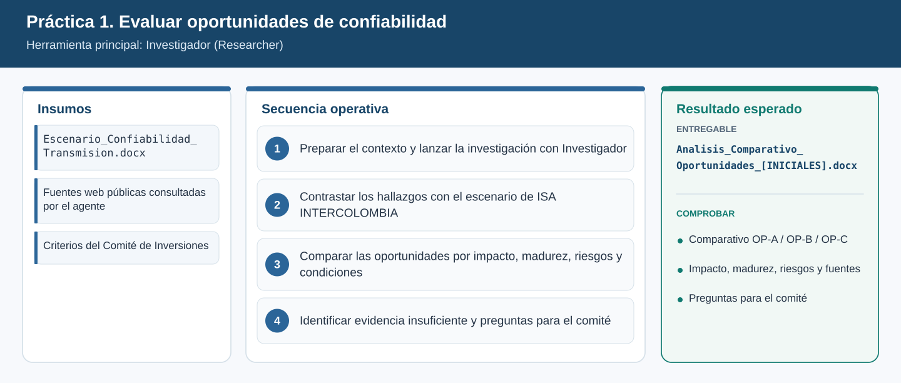
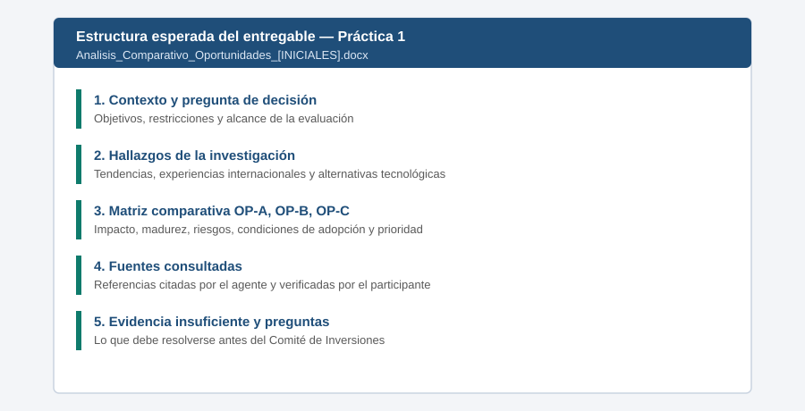

# Práctica 1. Evaluar oportunidades para fortalecer la confiabilidad de la infraestructura de transmisión

**Capítulo 1 (Módulo 1). Inteligencia estratégica y evaluación de decisiones**

## Objetivo de la práctica:
Al finalizar la práctica, serás capaz de:
- Seleccionar Investigador (Researcher) en lugar del chat de Microsoft 365 Copilot cuando una decisión requiere investigación profunda y con varias fuentes.
- Contrastar tendencias, experiencias internacionales y alternativas tecnológicas con las restricciones y los objetivos de un escenario de ISA INTERCOLOMBIA.
- Comparar oportunidades por impacto potencial, madurez tecnológica, riesgos de implementación y condiciones de adopción.
- Identificar evidencia insuficiente y preguntas que deben resolverse antes de presentar una recomendación al Comité de Inversiones.

## Objetivo visual


## Duración aproximada:
- 20 minutos.

| Tarea | Tiempo |
| --- | --- |
| Tarea 1. Preparar el contexto y lanzar la investigación | 8 min |
| Tarea 2. Contrastar los hallazgos con el escenario | 5 min |
| Tarea 3. Comparar las oportunidades | 4 min |
| Tarea 4. Identificar evidencia insuficiente y guardar el entregable | 3 min |

## Tabla de ayuda:
| Elemento | Valor |
| --- | --- |
| Aplicación | Aplicación Microsoft 365 Copilot ([m365.cloud.microsoft](https://m365.cloud.microsoft/)) |
| Agente | Investigador (Researcher) |
| Archivo de contexto | [Escenario_Confiabilidad_Transmision.docx](recursos/Escenario_Confiabilidad_Transmision.docx) |
| Ubicación en OneDrive | `Laboratorio_Copilot_ISA/Practica01/` (ver [Setup_Guide.md](../../Setup_Guide.md)) |
| Tiempo de respuesta de Investigador | Variable; ejecutar una sola investigación integrada antes de las consultas breves |
| Credenciales | Cuenta corporativa con licencia de Microsoft 365 Copilot. Se entrega por el canal autorizado; no se publica en este repositorio |
| Nombre del entregable | `Analisis_Comparativo_Oportunidades_[INICIALES].docx` |

## Instrucciones

### Tarea 1. Preparar el contexto y lanzar la investigación con Investigador
**Paso 1.** Examinar la siguiente tabla de criterios de selección. Investigador es la herramienta adecuada para esta práctica porque la decisión exige consultar fuentes externas e internas y comparar alternativas con evidencia.

| Necesidad directiva | Herramienta recomendada |
| --- | --- |
| Respuesta rápida, resumen o redacción sobre información conocida | Chat de Microsoft 365 Copilot |
| Investigación profunda con múltiples fuentes, comparativos y citas | Investigador (Researcher) |
| Análisis numérico de datos, tendencias y gráficos | Analista (Analyst) |
| Cuestionar una idea o propuesta antes de decidir | Entrenador de ideas (Idea Coach) |
| Tarea repetitiva con criterios propios de la organización | Agente personalizado (Agent Builder) |

**Paso 2.** Abrir el navegador, iniciar sesión en [https://m365.cloud.microsoft](https://m365.cloud.microsoft/) con la cuenta del laboratorio y seleccionar **Copilot** en la barra lateral.

**Paso 3.** Seleccionar **Agentes** en el panel izquierdo y elegir **Investigador**. Si no aparece, seleccionar **Todos los agentes** (o **Obtener agentes**) y buscarlo por nombre.

**Paso 4.** Escribir la siguiente instrucción. Para adjuntar el escenario, escribir `/` y seleccionar el archivo `Escenario_Confiabilidad_Transmision.docx` de OneDrive.

```text
Actúa como analista de estrategia de una empresa de transmisión de energía eléctrica en Colombia.
Investiga tendencias recientes (2022 en adelante), experiencias internacionales de empresas de
transmisión y alternativas tecnológicas para tres oportunidades:
OP-A monitoreo predictivo en línea de transformadores,
OP-B modernización de activos críticos con subestación digital,
OP-C eficiencia de la transmisión con capacidad dinámica de líneas y conductores de alta temperatura.
Usa el archivo /Escenario_Confiabilidad_Transmision como contexto de la empresa.
Para cada oportunidad incluye: beneficios demostrados, casos de referencia, madurez tecnológica,
riesgos, condiciones de adopción, fuentes citadas y evidencia que falta validar antes de decidir.
Compara OP-A/OP-B/OP-C en una tabla; distingue hechos de inferencias, y contrasta el impacto
con las restricciones del escenario. Indica cuándo un dato provenga de una sola fuente.
```

**Paso 5.** Responder las preguntas de aclaración que formule Investigador. Si pregunta por el alcance geográfico, indicar: "Latinoamérica, Europa y Norteamérica". Si pregunta por el horizonte, indicar: "2027 a 2029".

**Paso 6.** Leer el archivo del escenario y subrayar las cuatro restricciones de inversión de la sección 4. Las necesitará en la Tarea 2.

> **Validación:** el agente muestra el progreso de la investigación y, al terminar, entrega un informe con citas numeradas. Si después de 10 minutos no hay respuesta, consultar el historial de la conversación y verificar si la investigación finalizó; no duplicar consultas.

### Tarea 2. Contrastar los hallazgos con el escenario de ISA INTERCOLOMBIA
**Paso 1.** Leer el informe y abrir **al menos dos** citas para comprobar que la fuente existe y respalda la afirmación. Anotar cualquier cita que no corresponda.

**Paso 2.** Escribir en la misma conversación:

```text
Contrasta tus hallazgos con el escenario adjunto. Para cada oportunidad indica:
1) a qué objetivo estratégico 2027-2029 contribuye y en qué medida,
2) si cabe dentro del techo de CAPEX de 120.000 MCOP y del límite de 45.000 MCOP por iniciativa,
3) qué restricción interna podría impedir su adopción (personal especializado, consignaciones,
   ciberseguridad OT, datos).
Señala explícitamente cuándo tu conclusión es una inferencia y no un dato del escenario.
```

**Paso 3.** Verificar que la respuesta considere la limitación de **3 personas** en analítica de activos y la anticipación de **6 meses** para consignaciones. Si no las menciona, pedirlo de forma explícita.

### Tarea 3. Comparar las oportunidades por impacto, madurez, riesgos y condiciones
**Paso 1.** Solicitar la matriz comparativa:

```text
Elabora una tabla comparativa de OP-A, OP-B y OP-C con estas columnas:
impacto potencial en desconexiones no programadas (alto/medio/bajo y por qué),
madurez tecnológica en empresas comparables, riesgos de implementación,
condiciones necesarias para su adopción, costo relativo frente al techo de CAPEX,
fuentes que lo respaldan y una prioridad sugerida (1 a 3) con su criterio.
```

**Paso 2.** Revisar la prioridad sugerida. Si la tabla prioriza una opción solo por beneficio, pedir que reevalúe considerando las restricciones del escenario.

**Paso 3.** Establecer su propio criterio de priorización como directivo: aceptar, ajustar o rechazar la prioridad propuesta y escribir en una línea el porqué.

### Tarea 4. Identificar evidencia insuficiente y preguntas para el comité
**Paso 1.** Escribir:

```text
Identifica qué afirmaciones de este análisis tienen evidencia insuficiente, provienen de una sola
fuente o no aplican necesariamente a Colombia. Luego lista las preguntas que deberían resolverse
antes de presentar una recomendación al Comité de Inversiones, indicando qué área de la empresa
debería responder cada una.
```

**Paso 2.** Copiar el informe, la tabla comparativa y la lista de preguntas en un documento de Word nuevo. Usar el botón **Copiar** de cada respuesta o, si está disponible, la opción para editar o exportar la respuesta a un documento.

**Paso 3.** Agregar al inicio del documento una sección "Pregunta de decisión" con una frase y, al final, la sección "Fuentes consultadas" con las citas verificadas en la Tarea 2.

**Paso 4.** Guardar el documento en `Laboratorio_Copilot_ISA/Entregables/` con el nombre `Analisis_Comparativo_Oportunidades_[INICIALES].docx`.

### Resultado esperado
Análisis comparativo de oportunidades con beneficios, riesgos, fuentes y criterios de priorización.

**Comprobación de finalización:**
- Incluye las tres oportunidades (OP-A, OP-B y OP-C) en una misma matriz comparativa.
- Cada oportunidad tiene impacto, madurez tecnológica, riesgos, condiciones de adopción y fuentes.
- La priorización considera las restricciones del escenario (CAPEX, personal, consignaciones y ciberseguridad).
- Al menos dos citas fueron verificadas por el participante.
- Contiene una lista de evidencia insuficiente y de preguntas para el Comité de Inversiones con el área responsable.



---

[Inicio](../../README.md) | [Práctica 2](../Practica02/README.md)