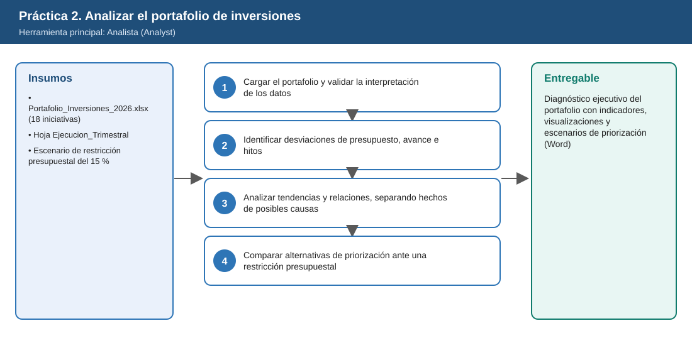
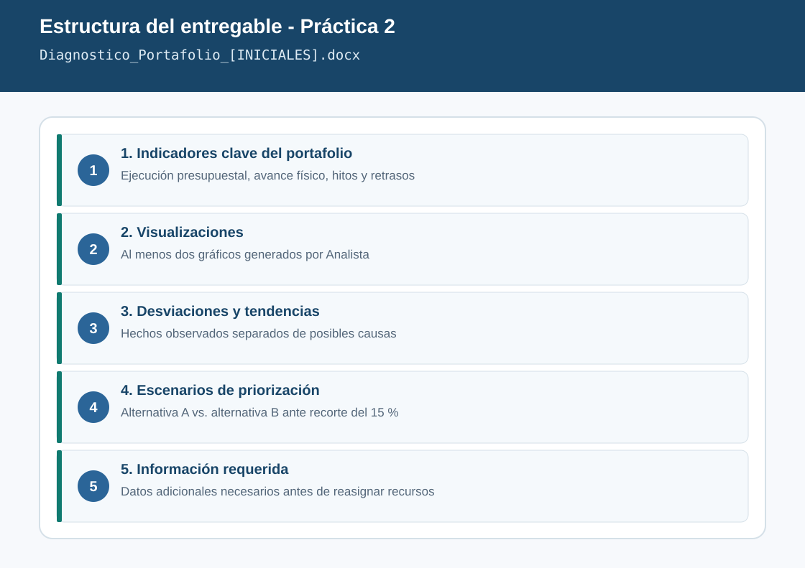

# Práctica 2. Analizar el desempeño del portafolio de inversiones con Analista

**Capítulo 1 (Módulo 1). Inteligencia estratégica y evaluación de decisiones**

## Objetivo de la práctica:
Al finalizar la práctica, serás capaz de:
- Utilizar Analista (Analyst) para examinar un archivo de Excel con presupuesto, hitos, beneficios, retrasos y riesgos de un portafolio de inversiones.
- Identificar desviaciones, tendencias y relaciones entre indicadores, diferenciando resultados observados de posibles causas.
- Comparar alternativas de priorización ante una restricción presupuestal y reconocer qué información adicional se requiere antes de reasignar recursos.

## Objetivo visual


## Duración aproximada:
- 20 minutos.

| Tarea | Tiempo |
| --- | --- |
| Tarea 1. Cargar el portafolio y validar la interpretación | 4 min |
| Tarea 2. Identificar desviaciones | 7 min |
| Tarea 3. Analizar tendencias y relaciones | 3 min |
| Tarea 4. Comparar alternativas ante restricción presupuestal | 6 min |

## Tabla de ayuda:
| Elemento | Valor |
| --- | --- |
| Aplicación | Aplicación Microsoft 365 Copilot ([m365.cloud.microsoft](https://m365.cloud.microsoft/)) |
| Agente | Analista (Analyst) |
| Archivo de datos | [Portafolio_Inversiones_2026.xlsx](recursos/Portafolio_Inversiones_2026.xlsx) |
| Hojas del archivo | `Portafolio` (18 iniciativas), `Ejecucion_Trimestral`, `Diccionario`, `Nota` |
| Unidad monetaria | Millones de pesos colombianos (MCOP) |
| Fecha de corte del dato | 30 de septiembre de 2026 |
| Tiempo de respuesta de Analista | Variable según el tamaño del archivo y la solicitud |
| Nombre del entregable | `Diagnostico_Portafolio_[INICIALES].docx` |

## Instrucciones

### Tarea 1. Cargar el portafolio y validar la interpretación de los datos
**Paso 1.** Seleccionar en la aplicación Microsoft 365 Copilot **Agentes** y elegir **Analista**.

**Paso 2.** Adjuntar el archivo `Portafolio_Inversiones_2026.xlsx` con el botón **+** (Agregar contenido) desde OneDrive, o escribir `/` y seleccionarlo.

**Paso 3.** Escribir:

```text
Revisa el archivo adjunto. Describe las hojas, las columnas de la hoja Portafolio y cómo
interpretas cada campo usando la hoja Diccionario. Confirma cuántas iniciativas hay por
categoría y el total de presupuesto aprobado y ejecutado. No hagas análisis todavía.
```

**Paso 4.** Comparar la respuesta con la hoja `Diccionario`. Verificar especialmente que Analista entienda que `Presupuesto_ejecutado_MCOP` **no incluye compromisos contractuales** pendientes.

> **Validación:** el total aprobado debe ser **153.850 MCOP** y el ejecutado **95.220 MCOP**. Si el agente obtiene otros valores, pedirle que muestre el cálculo y corregir la interpretación antes de continuar.

### Tarea 2. Identificar desviaciones de presupuesto, avance e hitos
**Paso 1.** Solicitar el análisis de desviaciones:

```text
Calcula para cada iniciativa:
- % de presupuesto ejecutado (ejecutado / aprobado),
- brecha de avance (avance real - avance planeado),
- cumplimiento de hitos (hitos cumplidos / hitos planeados a la fecha).
Muestra las 5 iniciativas con mayor brecha negativa de avance y las que tienen
% de presupuesto ejecutado mayor que su avance real. Presenta una tabla y un gráfico de barras.
```

**Paso 2.** Pedir una segunda visualización:

```text
Crea un gráfico de dispersión con días de retraso en el eje X y beneficio anual esperado
en el eje Y, con color por nivel de riesgo. Señala las iniciativas de prioridad estratégica 1.
```

**Paso 3.** Descargar o copiar ambos gráficos (botón de descarga o clic derecho sobre la imagen) para incluirlos en el entregable.

> **Validación:** las 5 mayores brechas negativas de avance son **INV-17** (-28 pts), **INV-08** (-26), **INV-11** (-15), **INV-03** (-14) e **INV-09** (-13). **INV-01 (PMS)** aparece en sexto lugar (-12) con 64 % del presupuesto ejecutado frente a 58 % de avance real. Si el resultado difiere, pedir al agente que muestre el criterio de orden utilizado.

### Tarea 3. Analizar tendencias y relaciones, separando hechos de posibles causas
**Paso 1.** Escribir:

```text
Usa la hoja Ejecucion_Trimestral para identificar qué iniciativas desaceleraron su ejecución
entre 2026-T1 y 2026-T3. Luego analiza si existe relación entre nivel de riesgo, días de retraso
y brecha de avance. Separa tu respuesta en dos secciones:
"Hechos observados en los datos" y "Posibles causas que requieren validación".
No presentes una causa como hecho si no está en los datos.
```

> **Validación:** la hoja trimestral muestra desaceleración de la ejecución en **INV-01**, **INV-03**, **INV-12** e **INV-17**; el resto del portafolio acelera su ejecución hacia el tercer trimestre.

**Paso 2.** Revisar que la sección "Posibles causas" no afirme hechos que no estén en el archivo (por ejemplo, causas del retraso del PMS que no aparezcan en la columna `Riesgo_principal`).

### Tarea 4. Comparar alternativas de priorización ante una restricción presupuestal
**Paso 1.** Introducir el escenario de restricción:

```text
Escenario: la Dirección Financiera anuncia que el presupuesto pendiente por ejecutar
(aprobado - ejecutado) de todo el portafolio se reducirá 15 % para 2027.
Compara dos alternativas:
A) recorte proporcional a todas las iniciativas excepto las de prioridad estratégica 1;
B) recorte según la relación entre beneficio anual esperado y presupuesto pendiente,
   protegiendo las iniciativas con riesgo alto y prioridad 1.
Para cada alternativa muestra el monto recortado por iniciativa, el beneficio anual en riesgo
y las iniciativas más afectadas. Presenta una tabla resumen comparativa.
```

**Paso 2.** Solicitar los límites del análisis:

```text
¿Qué información adicional, que no está en este archivo, se requiere antes de reasignar recursos?
Considera compromisos contractuales, obligaciones regulatorias, dependencias entre iniciativas
y beneficios no cuantificados (beneficio = 0).
```

**Paso 3.** Crear un documento de Word con los siguientes apartados: indicadores clave, visualizaciones, desviaciones y tendencias, escenarios de priorización e información requerida. Agregar una conclusión de máximo cinco líneas escrita por usted con la alternativa que recomiendaría y su condición principal.

**Paso 4.** Guardar como `Laboratorio_Copilot_ISA/Entregables/Diagnostico_Portafolio_[INICIALES].docx`.

### Resultado esperado
Diagnóstico ejecutivo del portafolio con indicadores, visualizaciones y escenarios de priorización.

**Comprobación de finalización:**
- Presenta los totales validados del portafolio y los indicadores de ejecución, avance e hitos.
- Incluye al menos dos visualizaciones generadas por Analista.
- Distingue explícitamente hechos observados de posibles causas.
- Compara las alternativas A y B con monto recortado y beneficio en riesgo.
- Lista la información adicional requerida antes de reasignar recursos y una conclusión del participante.



---

[Práctica 1](../Practica01/README.md) | [Inicio](../../README.md) | [Práctica 3](../Practica03/README.md)