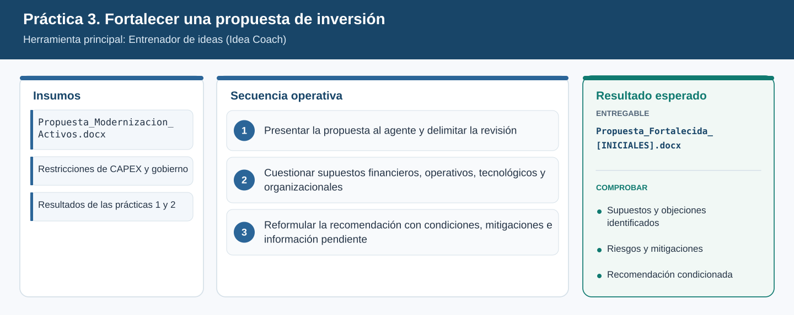
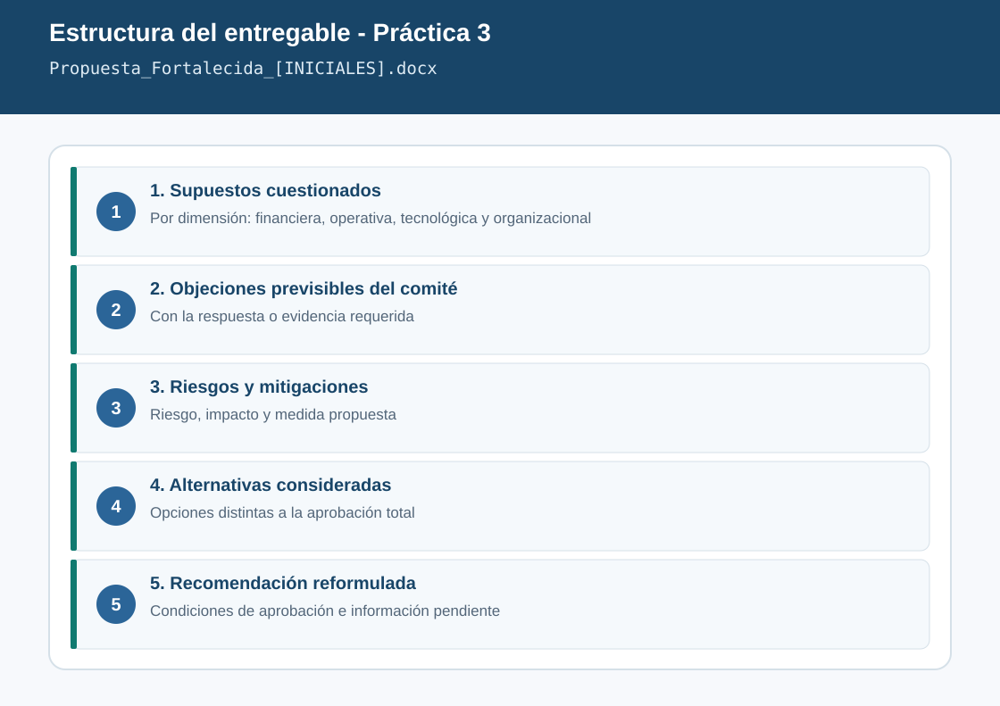

# Práctica 3. Fortalecer una propuesta de inversión mediante evaluación crítica

**Capítulo 1 (Módulo 1). Inteligencia estratégica y evaluación de decisiones**

## Objetivo de la práctica:
Al finalizar la práctica, serás capaz de:
- Utilizar Entrenador de ideas (Idea Coach) para examinar críticamente una propuesta de inversión antes de presentarla para aprobación.
- Cuestionar los supuestos financieros, operativos, tecnológicos y organizacionales de la propuesta, identificando riesgos, objeciones y alternativas.
- Reformular la recomendación incorporando condiciones de aprobación, medidas de mitigación e información pendiente de validación.

## Objetivo Visual


## Duración aproximada:
- 15 minutos.

| Tarea | Tiempo |
| --- | --- |
| Tarea 1. Presentar la propuesta al agente | 3 min |
| Tarea 2. Cuestionar los supuestos | 6 min |
| Tarea 3. Reformular la recomendación | 6 min |

## Tabla de ayuda:
| Elemento | Valor |
| --- | --- |
| Aplicación | Aplicación Microsoft 365 Copilot ([m365.cloud.microsoft](https://m365.cloud.microsoft/)) |
| Agente | Entrenador de ideas (Idea Coach) |
| Propuesta a revisar | [Propuesta_Modernizacion_Activos.docx](recursos/Propuesta_Modernizacion_Activos.docx) |
| Referencias de las prácticas anteriores | Entregables de las prácticas 1 y 2 (opcional) |
| Datos clave | CAPEX 86.000 MCOP; techo 2027-2029: 120.000 MCOP; límite sin Junta Directiva: 45.000 MCOP |
| Nombre del entregable | `Propuesta_Fortalecida_[INICIALES].docx` |

## Instrucciones

### Tarea 1. Presentar la propuesta al agente y delimitar la revisión.

Paso 1. En la aplicación Microsoft 365 Copilot, seleccionar **Agentes** y elegir **Entrenador de ideas**. Si no aparece en la lista, buscarlo en **Todos los agentes**.

Paso 2. Escribir la siguiente instrucción y adjuntar la propuesta con `/` o con el botón **+**:

```text
Soy directivo de una empresa de transmisión de energía. Antes de presentar la propuesta adjunta
al Comité de Inversiones quiero que actúes como un evaluador exigente. No la mejores todavía:
primero resume en 5 líneas qué propone, cuánto cuesta, qué beneficios promete y qué decisión pide.
```

Paso 3. Verificar que el resumen incluya **86.000 MCOP**, **24 transformadores**, **12 subestaciones**, **30 meses** y la solicitud de aprobar la totalidad de la inversión.

> **Si el agente no puede leer el archivo adjunto:** abrir el documento, copiar las secciones 1 a 8 y pegarlas en el cuadro de mensaje antes de la instrucción.

### Tarea 2. Cuestionar supuestos financieros, operativos, tecnológicos y organizacionales.

Paso 1. Escribir:

```text
Cuestiona los supuestos de la propuesta en cuatro dimensiones: financiera, operativa,
tecnológica y organizacional. Para cada supuesto indica:
por qué podría no cumplirse, qué evidencia lo respaldaría y qué riesgo genera si falla.
Considera también la información de referencia de la sección 8 del documento.
```

Paso 2. Comprobar que el agente cuestione, como mínimo, estos supuestos débiles sembrados en la propuesta:

| Dimensión | Supuesto que debe ser cuestionado |
| --- | --- |
| Financiera | Tasa de cambio fija, ahorro completo desde el año 1 y ausencia de análisis de sensibilidad |
| Financiera / gobierno | 86.000 MCOP supera el límite de 45.000 MCOP y requiere Junta Directiva; consume 72 % del techo de CAPEX |
| Operativa | Entrega de transformadores en 6 meses (el PMS ya acumula 75 días de retraso) y montaje sin consignaciones adicionales |
| Tecnológica | Integración al SCADA sin adecuaciones y ciberseguridad "resuelta durante la ejecución" |
| Organizacional | Sin personal adicional, sin gestión del cambio y validación de Operación tardía |

Paso 3. Si alguno no aparece, preguntarlo directamente. Ejemplo: "¿Es realista entregar transformadores en 6 meses si un programa en curso tiene 75 días de retraso con el mismo tipo de equipos?".

Paso 4. Solicitar las objeciones y alternativas:

```text
¿Qué 5 objeciones haría un comité de inversiones exigente y qué respuesta o evidencia necesitaría
el área proponente para cada una? Propón al menos dos alternativas a la aprobación total,
por ejemplo un enfoque por fases o la combinación con monitoreo predictivo.
```

### Tarea 3. Reformular la recomendación con condiciones, mitigaciones e información pendiente.

Paso 1. Escribir:

```text
Reformula la recomendación final de la propuesta para que sea defendible ante el comité.
Incluye: decisión que se solicita (puede ser parcial o por fases), condiciones de aprobación,
medidas de mitigación por riesgo principal, información pendiente de validación con su responsable
y fecha sugerida. Usa un lenguaje ejecutivo y máximo una página.
```

Paso 2. Evaluar la nueva recomendación como directivo: ¿la presentaría al comité? Escribir en una frase qué cambiaría y pedir al agente el ajuste.

Paso 3. Crear un documento de Word con las secciones del resultado esperado y guardarlo como `Laboratorio_Copilot_ISA/Entregables/Propuesta_Fortalecida_[INICIALES].docx`.

### Entregable
Propuesta fortalecida con objeciones, riesgos y condiciones para decisión.

Criterios de verificación:
- [ ] Cuestiona supuestos en las cuatro dimensiones (financiera, operativa, tecnológica y organizacional).
- [ ] Identifica que la propuesta requiere aprobación de Junta Directiva por superar 45.000 MCOP.
- [ ] Incluye al menos cinco objeciones previsibles con la evidencia necesaria para responderlas.
- [ ] Presenta al menos dos alternativas a la aprobación total.
- [ ] La recomendación reformulada contiene condiciones de aprobación, mitigaciones e información pendiente con responsable.

### Resultado esperado


---

[⬅ Anterior: Práctica 2](../../Capitulo01/Practica02/README.md) | [Inicio](../../README.md) | [Siguiente: Práctica 4 ➡](../../Capitulo02/Practica04/README.md)
