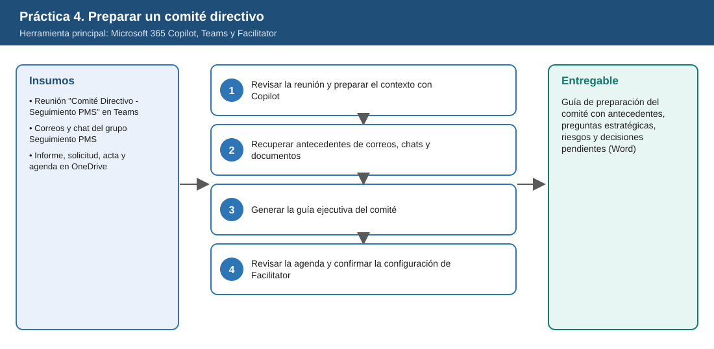
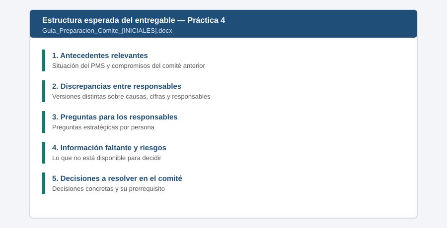

# Práctica 4. Preparar un comité directivo con información de diferentes fuentes

**Capítulo 2 (Módulo 2). Preparación de comités y gobierno de iniciativas**

## Objetivo de la práctica:
Al finalizar la práctica, serás capaz de:
- Utilizar la preparación de reuniones con Copilot para revisar el contexto de un comité programado en Teams.
- Recuperar antecedentes de correos de Outlook, conversaciones de Teams y documentos de OneDrive y SharePoint para identificar compromisos previos, discrepancias entre responsables y asuntos que requieren decisión.
- Generar una guía ejecutiva con antecedentes, preguntas estratégicas, información faltante, posibles desacuerdos y decisiones pendientes.
- Revisar la agenda y confirmar la configuración de Facilitator antes de la reunión.

## Objetivo Visual


## Duración aproximada:
- 20 minutos.

| Tarea | Tiempo |
| --- | --- |
| Tarea 1. Revisar la reunión y preparar el contexto con Copilot | 5 min |
| Tarea 2. Recuperar antecedentes de correos, chats y documentos | 6 min |
| Tarea 3. Generar la guía ejecutiva del comité | 6 min |
| Tarea 4. Revisar la agenda y confirmar Facilitator | 3 min |

## Tabla de ayuda:
| Elemento | Valor |
| --- | --- |
| Reunión en el calendario | `Comité Directivo - Seguimiento PMS` (programada por el instructor; ver [Setup_Guide.md](../../Setup_Guide.md)) |
| Correos en el buzón | Asuntos `PMS - causas del retraso`, `RE: PMS - causas del retraso` y `Validación sobrecosto PMS` |
| Chat de Teams | Grupo `Seguimiento PMS` |
| Documentos en OneDrive | [Informe_Avance_PMS_Oct2026.docx](recursos/Informe_Avance_PMS_Oct2026.docx), [Solicitud_Recursos_Adicionales_PMS.docx](recursos/Solicitud_Recursos_Adicionales_PMS.docx), [Acta_Comite_Directivo_2026-09-24.docx](recursos/Acta_Comite_Directivo_2026-09-24.docx), [Agenda_Comite_Directivo_PMS.docx](recursos/Agenda_Comite_Directivo_PMS.docx) |
| Guion usado para sembrar correos y chat | [Correos_y_Chats_Comite_PMS.docx](recursos/Correos_y_Chats_Comite_PMS.docx) (solo para el instructor) |
| Fecha de corte del escenario | 6 de noviembre de 2026 |
| Nombre del entregable | `Guia_Preparacion_Comite_[INICIALES].docx` |

## Instrucciones

### Tarea 1. Revisar la reunión y preparar el contexto con Copilot.

Paso 1. Abrir **Microsoft Teams** (aplicación de escritorio o [teams.microsoft.com](https://teams.microsoft.com/)) y seleccionar **Calendario**.

Paso 2. Abrir el evento `Comité Directivo - Seguimiento PMS` y revisar organizador, asistentes, descripción y archivos adjuntos.

Paso 3. Seleccionar la opción de preparación con Copilot que muestre el evento (por ejemplo, **Preparar con Copilot** o **Prep**). Revisar el resumen de contexto que genera: correos, chats y archivos relacionados con la reunión.

> **Si la opción de preparación no aparece:** abrir Copilot en Teams o en la aplicación Microsoft 365 Copilot y escribir: `Ayúdame a preparar la reunión /Comité Directivo - Seguimiento PMS`, seleccionando la reunión al escribir `/`.

Paso 4. Anotar qué fuentes encontró Copilot y cuáles no aparecen (por ejemplo, el acta del comité anterior). Las fuentes faltantes se agregarán explícitamente en la Tarea 2.

### Tarea 2. Recuperar antecedentes de correos, chats y documentos.

Paso 1. En el chat de Copilot, escribir y referenciar cada fuente con `/`:

```text
Revisa /Acta_Comite_Directivo_2026-09-24 y lista los compromisos con responsable y fecha.
Luego busca en mis correos de Outlook, en el chat de Teams "Seguimiento PMS" y en
/Informe_Avance_PMS_Oct2026 y /Solicitud_Recursos_Adicionales_PMS el estado de cada compromiso.
Indica la fuente de cada afirmación.
```

Paso 2. Solicitar las discrepancias:

```text
Identifica discrepancias entre lo que dicen los distintos responsables sobre:
1) la causa del retraso de 75 días,
2) la validez de la proyección de sobrecosto,
3) quién es responsable de la validación de ciberseguridad.
Para cada discrepancia muestra quién dice qué y en qué fuente.
```

> **Validación:** Copilot debe encontrar al menos tres discrepancias: la causa del retraso (proveedor vs. especificaciones entregadas 7 semanas tarde), la tasa de cambio usada en la proyección y la validación de ciberseguridad sin responsable asignado. Si no las encuentra, verificar que los correos y el chat existan en la cuenta y referenciarlos con `/`.

### Tarea 3. Generar la guía ejecutiva del comité.

Paso 1. Escribir:

```text
Con base en lo anterior, elabora una guía ejecutiva para presidir el comité con estas secciones:
1) Antecedentes relevantes (máximo 5 viñetas),
2) Estado de los compromisos del comité anterior,
3) Discrepancias entre responsables,
4) Preguntas estratégicas para cada responsable,
5) Información faltante para decidir sobre la solicitud de 6.800 MCOP,
6) Posibles desacuerdos durante la sesión,
7) Decisiones que deberían resolverse y su prerrequisito.
No recomiendes aprobar o rechazar la solicitud; esa decisión corresponde al comité.
```

Paso 2. Revisar que cada pregunta estratégica esté dirigida a una persona concreta (Gerente PMS, Líder de Abastecimiento, Director Financiero, Director de TI y TO).

Paso 3. Copiar la guía en un documento de Word y guardarlo como `Laboratorio_Copilot_ISA/Entregables/Guia_Preparacion_Comite_[INICIALES].docx`. Adjuntar el documento al evento de la reunión.

### Tarea 4. Revisar la agenda y confirmar la configuración de Facilitator.

Paso 1. Comparar la agenda del evento con la guía. Si la guía identifica una decisión que no está en la agenda (por ejemplo, asignar el responsable de ciberseguridad OT), agregarla en la descripción del evento.

Paso 2. En el evento, abrir **Opciones de reunión** y localizar la sección de **Copilot y agentes** (el nombre puede variar según la versión de Teams).

Paso 3. Confirmar que **Facilitator** esté habilitado para la reunión y que la transcripción esté permitida, de acuerdo con la política de la organización. Guardar los cambios.

Paso 4. **No iniciar una reunión de prueba.** La configuración se usará durante la sesión real del comité.

> **Si Facilitator no aparece en las opciones:** registrar la situación en el entregable e informar al instructor. La habilitación depende de la directiva de Teams definida por el administrador (ver [Setup_Guide.md](../../Setup_Guide.md)).

### Entregable
Guía de preparación del comité con antecedentes, preguntas estratégicas, riesgos y decisiones pendientes.

Criterios de verificación:
- [ ] Recupera los cuatro compromisos del comité del 24 de septiembre y su estado actual con la fuente.
- [ ] Identifica al menos tres discrepancias entre responsables con la fuente de cada versión.
- [ ] Incluye preguntas estratégicas dirigidas a responsables concretos.
- [ ] Lista la información faltante y las decisiones a resolver, sin recomendar aprobar o rechazar.
- [ ] La guía está adjunta al evento y Facilitator quedó confirmado o la limitación quedó documentada.

### Resultado esperado


---

[⬅ Anterior: Práctica 3](../../Capitulo01/Practica03/README.md) | [Inicio](../../README.md) | [Siguiente: Práctica 5 ➡](../../Capitulo02/Practica05/README.md)
