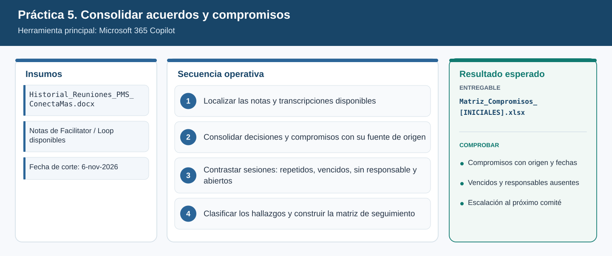
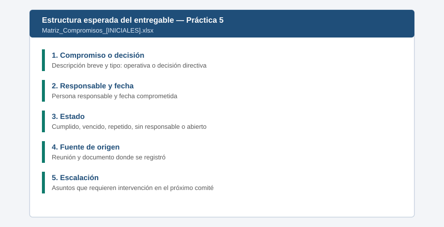

# Práctica 5. Consolidar acuerdos y detectar compromisos sin seguimiento

**Capítulo 2 (Módulo 2). Preparación de comités y gobierno de iniciativas**

## Objetivo de la práctica:
Al finalizar la práctica, serás capaz de:
- Utilizar Microsoft 365 Copilot para consultar notas de Facilitator (Loop) y transcripciones de varias reuniones de seguimiento.
- Consolidar decisiones, acuerdos, responsables, fechas y compromisos pendientes, identificando la reunión y la fuente de origen de cada elemento.
- Detectar acuerdos repetidos, actividades vencidas, decisiones sin responsable y asuntos abiertos, diferenciando actividades operativas de decisiones directivas.
- Elaborar una matriz de seguimiento para revisar el cumplimiento de acuerdos en el siguiente comité.

## Objetivo Visual


## Duración aproximada:
- 18 minutos.

| Tarea | Tiempo |
| --- | --- |
| Tarea 1. Localizar las notas y transcripciones | 3 min |
| Tarea 2. Consolidar decisiones y compromisos | 6 min |
| Tarea 3. Contrastar las sesiones | 5 min |
| Tarea 4. Clasificar hallazgos y construir la matriz | 4 min |

## Tabla de ayuda:
| Elemento | Valor |
| --- | --- |
| Aplicación | Microsoft 365 Copilot (aplicación o Copilot en Teams) |
| Notas de Facilitator (Loop) | Página de Loop `Notas Comité de iniciativas 22-oct` preparada por el instructor. Contenido de referencia: [Notas_Facilitator_Comite_2026-10-22.docx](recursos/Notas_Facilitator_Comite_2026-10-22.docx) |
| Transcripciones | [Transcripcion_PMS_2026-09-10.docx](recursos/Transcripcion_PMS_2026-09-10.docx), [Transcripcion_PMS_2026-10-08.docx](recursos/Transcripcion_PMS_2026-10-08.docx), [Transcripcion_ConectaMas_2026-10-15.docx](recursos/Transcripcion_ConectaMas_2026-10-15.docx) |
| Ubicación en OneDrive | `Laboratorio_Copilot_ISA/Practica05/` |
| Fecha de corte del escenario | 6 de noviembre de 2026 (para determinar compromisos vencidos) |
| Nombre del entregable | `Matriz_Compromisos_[INICIALES].xlsx` |

## Instrucciones

### Tarea 1. Localizar las notas y transcripciones disponibles.

Paso 1. Abrir la aplicación Microsoft 365 Copilot y seleccionar el chat de **Copilot** (no un agente).

Paso 2. Escribir `/` y comprobar que aparecen la página de Loop de notas y los tres archivos de transcripción. Si alguno no aparece, buscarlo por nombre en OneDrive y abrirlo una vez para que esté disponible.

Paso 3. Escribir:

```text
Lista las fuentes que te comparto y para cada una indica la fecha de la reunión, el tema
(PMS o Conecta+) y los participantes:
/Notas Comité de iniciativas 22-oct /Transcripcion_PMS_2026-09-10
/Transcripcion_PMS_2026-10-08 /Transcripcion_ConectaMas_2026-10-15
```

> **Validación:** Copilot identifica cuatro reuniones: 10-sep (PMS), 08-oct (PMS), 15-oct (Conecta+) y 22-oct (comité con ambas iniciativas).

### Tarea 2. Consolidar decisiones y compromisos con su fuente de origen.

Paso 1. Escribir:

```text
Consolida en una tabla todas las decisiones y compromisos de las cuatro fuentes con estas columnas:
ID, descripción, tipo (decisión o compromiso), responsable, fecha comprometida,
reunión de origen y fuente (nombre del archivo o página).
Si el responsable o la fecha no se mencionan, escribe "No definido". No inventes datos.
```

Paso 2. Verificar en la fuente original al menos dos elementos de la tabla (abrir el archivo y buscar la frase).

### Tarea 3. Contrastar sesiones: repetidos, vencidos, sin responsable y abiertos.

Paso 1. Escribir:

```text
Toma como fecha de corte el 6 de noviembre de 2026. Contrasta los compromisos entre reuniones e identifica:
1) acuerdos repetidos en más de una reunión (indica cuántas veces y si cambió la fecha),
2) compromisos vencidos a la fecha de corte,
3) decisiones o acciones sin responsable,
4) asuntos que siguen abiertos aunque ya se trataron antes.
Indica la evidencia de cada hallazgo.
```

> **Validación:** el resultado debe incluir, como mínimo: plan de contingencia de suministro (repetido en 3 reuniones, fecha movida y vencido), validación del sobrecosto (repetido y vencido), validación de ciberseguridad OT (sin responsable en 3 reuniones), decisión de re-secuenciación (sin responsable de la decisión) y mensaje oficial a clientes de Conecta+ (sin responsable).

### Tarea 4. Clasificar los hallazgos y construir la matriz de seguimiento.

Paso 1. Escribir:

```text
Clasifica cada elemento como "Actividad operativa" o "Decisión directiva" y asigna un estado:
Cumplido, En curso, Vencido, Repetido sin avance, Sin responsable.
Agrega una columna "Requiere intervención directiva (Sí/No)" con la justificación.
Entrega la tabla final lista para copiar en Excel.
```

Paso 2. Copiar la tabla en un libro de Excel nuevo. Si Copilot ofrece la opción de exportar o abrir la tabla en Excel, usarla.

Paso 3. Aplicar un filtro a la columna "Requiere intervención directiva" y crear una segunda hoja llamada `Escalacion` con los asuntos que se llevarán al siguiente comité.

Paso 4. Guardar como `Laboratorio_Copilot_ISA/Entregables/Matriz_Compromisos_[INICIALES].xlsx`.

### Entregable
Matriz consolidada de compromisos y decisiones, con responsables, fechas, estado, fuente de origen y asuntos para escalación.

Criterios de verificación:
- [ ] Contiene los compromisos y decisiones de las cuatro reuniones con su fuente de origen.
- [ ] Identifica acuerdos repetidos, vencidos a la fecha de corte, sin responsable y abiertos.
- [ ] Diferencia actividades operativas de decisiones directivas.
- [ ] Incluye la hoja `Escalacion` con los asuntos que requieren intervención directiva.
- [ ] No contiene responsables ni fechas inventados (los datos ausentes figuran como "No definido").

### Resultado esperado


---

[⬅ Anterior: Práctica 4](../../Capitulo02/Practica04/README.md) | [Inicio](../../README.md) | [Siguiente: Práctica 6 ➡](../../Capitulo02/Practica06/README.md)
