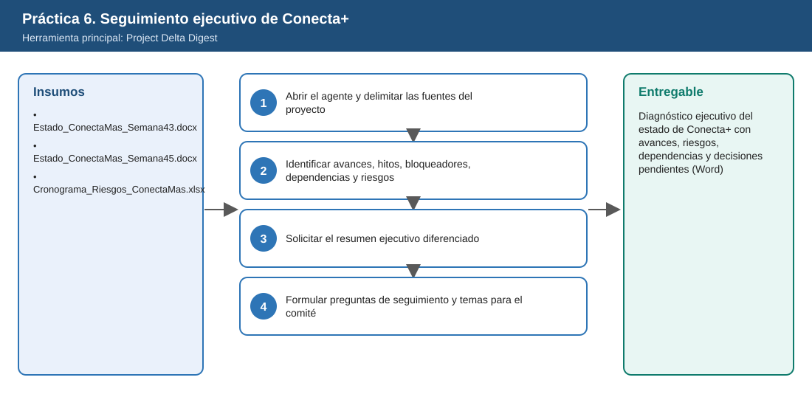
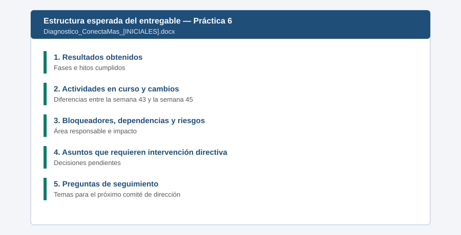

# Práctica 6. Seguimiento ejecutivo de una iniciativa de transformación digital con Project Delta Digest

**Capítulo 2 (Módulo 2). Preparación de comités y gobierno de iniciativas**

## Objetivo de la práctica:
Al finalizar la práctica, serás capaz de:
- Utilizar Project Delta Digest para consultar el estado de la iniciativa Conecta+ de transformación digital de la gestión de solicitudes y atención a clientes.
- Identificar avances, hitos pendientes, bloqueadores, dependencias entre áreas y riesgos que podrían afectar la implementación.
- Obtener un resumen ejecutivo que distinga resultados obtenidos, actividades en curso y asuntos que requieren intervención directiva.
- Formular preguntas de seguimiento y definir los aspectos que deben revisarse en el próximo comité de dirección.

## Objetivo Visual


## Duración aproximada:
- 22 minutos.

| Tarea | Tiempo |
| --- | --- |
| Tarea 1. Abrir el agente y delimitar las fuentes | 4 min |
| Tarea 2. Identificar avances, hitos, bloqueadores, dependencias y riesgos | 7 min |
| Tarea 3. Solicitar el resumen ejecutivo | 6 min |
| Tarea 4. Formular preguntas y temas para el comité | 5 min |

## Tabla de ayuda:
| Elemento | Valor |
| --- | --- |
| Agente | Project Delta Digest |
| Iniciativa | Conecta+ (ficticia): portal único de solicitudes, integración con CRM y facturación, gestión del cambio |
| Fuentes del proyecto | [Estado_ConectaMas_Semana43.docx](recursos/Estado_ConectaMas_Semana43.docx), [Estado_ConectaMas_Semana45.docx](recursos/Estado_ConectaMas_Semana45.docx), [Cronograma_Riesgos_ConectaMas.xlsx](recursos/Cronograma_Riesgos_ConectaMas.xlsx) |
| Ubicación | Biblioteca de documentos del sitio de laboratorio `Conecta+` o `Laboratorio_Copilot_ISA/Practica06/` en OneDrive (ver [Setup_Guide.md](../../Setup_Guide.md)) |
| Fecha de corte del escenario | 6 de noviembre de 2026 |
| Nombre del entregable | `Diagnostico_ConectaMas_[INICIALES].docx` |

> **Importante:** el entregable de esta práctica se reutiliza en las prácticas 9 y 11. Guárdelo con el nombre indicado.

## Instrucciones

### Tarea 1. Abrir el agente y delimitar las fuentes del proyecto.

Paso 1. En la aplicación Microsoft 365 Copilot, seleccionar **Agentes** y abrir **Project Delta Digest**. Si no está en la lista, buscarlo en **Todos los agentes** y seleccionarlo.

Paso 2. Revisar la descripción del agente y las instrucciones iniciales sugeridas para identificar qué fuentes consulta (documentos, sitio de SharePoint, correos o tareas).

Paso 3. Escribir, referenciando los archivos con `/`:

```text
Quiero conocer el estado de la iniciativa Conecta+ de ISA INTERCOLOMBIA. Usa como fuentes
/Estado_ConectaMas_Semana43 /Estado_ConectaMas_Semana45 y /Cronograma_Riesgos_ConectaMas.
Primero confirma qué fuentes leíste y la fecha de cada una.
```

> **Validación:** el agente confirma las tres fuentes. Si responde con información de otro proyecto, pedirle que se limite a las fuentes indicadas.

### Tarea 2. Identificar avances, hitos, bloqueadores, dependencias y riesgos.

Paso 1. Escribir:

```text
¿Qué cambió entre la semana 43 y la semana 45? Presenta una tabla con:
avance por fase en cada semana, hitos que cambiaron de fecha (fecha anterior y nueva),
bloqueadores nuevos o que persisten, dependencias con otras áreas
(TI, Jurídica, Comercial, Talento Humano, Operación) y riesgos con su impacto.
```

Paso 2. Verificar los cambios clave en la tabla:

| Elemento | Semana 43 | Semana 45 |
| --- | --- | --- |
| Avance F2 Portal | 60 % | 65 % |
| Piloto con 5 clientes | 2026-12-01 | 2027-02-02 |
| Salida en vivo general | 2027-03-15 | 2027-04-15 |
| Otrosí del integrador | Pendiente de Jurídica | Sin aprobar; el integrador anuncia pausa de la F3 desde el 1-dic |
| Comunicación a clientes | No reportada | Se comunicó enero de 2027 (fecha no aprobada) |

Paso 3. Si el agente omite algún cambio, preguntarlo directamente. Ejemplo: "¿Qué dice la semana 45 sobre la comunicación de fechas a clientes?".

### Tarea 3. Solicitar el resumen ejecutivo diferenciado.

Paso 1. Escribir:

```text
Elabora un resumen ejecutivo de una página para la alta dirección con tres secciones separadas:
1) Resultados obtenidos (lo terminado y verificable),
2) Actividades en curso (con avance y fecha vigente),
3) Asuntos que requieren intervención directiva (decisión requerida, área responsable,
   consecuencia de no decidir).
Usa lenguaje ejecutivo, sin tecnicismos.
```

Paso 2. Revisar que la sección 3 incluya, como mínimo: aprobación del otrosí del integrador, asignación del segundo analista de gestión del cambio y definición del mensaje oficial a clientes sobre las fechas.

Paso 3. Comprobar que el resumen no mezcle resultados con actividades en curso (por ejemplo, el portal **no** está terminado).

### Tarea 4. Formular preguntas de seguimiento y temas para el comité.

Paso 1. Escribir:

```text
Propón 6 preguntas de seguimiento para la líder del proyecto y los responsables de TI,
Jurídica y Comercial, y lista los 3 aspectos que deberían revisarse en el próximo comité
de dirección, con la decisión esperada para cada uno.
```

Paso 2. Ajustar al menos una pregunta según su criterio directivo (por ejemplo, agregar el impacto en clientes del piloto).

Paso 3. Consolidar la tabla de cambios, el resumen ejecutivo y las preguntas en un documento de Word y guardarlo como `Laboratorio_Copilot_ISA/Entregables/Diagnostico_ConectaMas_[INICIALES].docx`.

### Entregable
Diagnóstico ejecutivo del estado de la iniciativa, con avances, riesgos, dependencias y decisiones pendientes.

Criterios de verificación:
- [ ] Muestra los cambios entre la semana 43 y la 45, incluidas las nuevas fechas del piloto y de la salida en vivo.
- [ ] Identifica bloqueadores, dependencias por área y riesgos con su impacto.
- [ ] El resumen separa resultados obtenidos, actividades en curso y asuntos que requieren intervención directiva.
- [ ] Incluye preguntas de seguimiento dirigidas a responsables y temas para el próximo comité.
- [ ] El archivo está guardado con el nombre indicado para reutilizarlo en las prácticas 9 y 11.

### Resultado esperado


---

[⬅ Anterior: Práctica 5](../../Capitulo02/Practica05/README.md) | [Inicio](../../README.md) | [Siguiente: Práctica 7 ➡](../../Capitulo03/Practica07/README.md)
