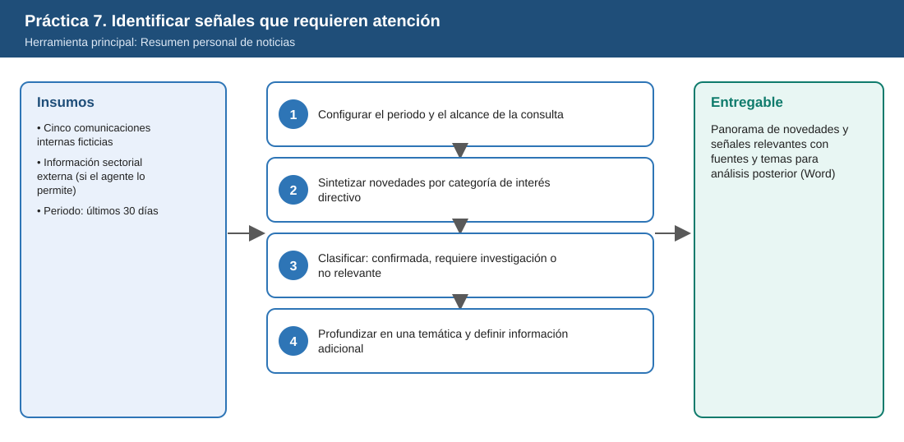
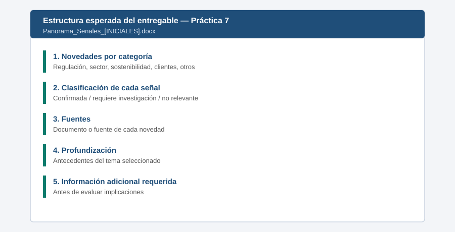

# Práctica 7. Identificar señales externas e internas que requieren atención directiva

**Capítulo 3 (Módulo 3). Inteligencia organizacional y comunicación ejecutiva**

## Objetivo de la práctica:
Al finalizar la práctica, serás capaz de:
- Utilizar Resumen personal de noticias para identificar novedades relevantes para ISA INTERCOLOMBIA en un periodo determinado, a partir de comunicaciones internas y, cuando el agente lo permita, fuentes sectoriales externas.
- Sintetizar novedades sobre cambios regulatorios, tendencias del sector energético, sostenibilidad, requerimientos de clientes y acontecimientos que afecten las prioridades de las áreas.
- Distinguir información confirmada, asuntos que requieren mayor investigación y novedades sin impacto relevante.
- Profundizar en una temática para comprender sus antecedentes y definir la información adicional necesaria antes de evaluar implicaciones.

## Objetivo visual


## Duración aproximada:
- 16 minutos.

| Tarea | Tiempo |
| --- | --- |
| Tarea 1. Configurar el periodo y el alcance | 3 min |
| Tarea 2. Sintetizar novedades por categoría | 5 min |
| Tarea 3. Clasificar las señales | 4 min |
| Tarea 4. Profundizar en una temática | 4 min |

## Tabla de ayuda:
| Elemento | Valor |
| --- | --- |
| Agente | Resumen personal de noticias |
| Fuente de comunicaciones | [Panorama_Senales_Organizacionales.docx](recursos/Panorama_Senales_Organizacionales.docx): contiene cinco secciones diferenciadas por origen y asunto. |
| Ubicación | `Laboratorio_Copilot_ISA/Practica07/` en OneDrive o sitio de comunicaciones del laboratorio |
| Periodo de consulta | 10-oct a 09-nov-2026 (ventana fija del escenario) |
| Nombre del entregable | `Panorama_Senales_[INICIALES].docx` |

## Instrucciones

### Tarea 1. Configurar el periodo y el alcance de la consulta
**Paso 1.** Abrir en la aplicación Microsoft 365 Copilot **Agentes** y seleccionar **Resumen personal de noticias**.

**Paso 2.** Revisar las opciones o instrucciones iniciales del agente para identificar si permite elegir temas, periodo y fuentes externas. Si el agente solicita preferencias, indicar: sector energético, transmisión eléctrica, regulación, sostenibilidad y clientes.

**Paso 3.** Escribir:

```text
Prepara mi resumen de novedades de el periodo del 10 de octubre al 9 de noviembre de 2026 como directivo de ISA INTERCOLOMBIA.
Considera las comunicaciones internas a las que tengo acceso, en especial
/Panorama_Senales_Organizacionales (secciones: Regulación, Sostenibilidad,
Requerimientos de clientes, Abastecimiento y Bienestar)
y, si puedes, noticias públicas del sector de transmisión eléctrica en Colombia y Latinoamérica.
Indica la fuente de cada novedad y si es interna o externa.
```

> **Validación:** el resumen identifica al menos las cinco secciones de las comunicaciones internas, con sus respectivas fuentes. Si el agente no permite adjuntar archivos directamente, usar las fuentes configuradas y publicar el dossier de comunicaciones en el entorno según [Setup_Guide.md](../../Setup_Guide.md).

### Tarea 2. Sintetizar novedades por categoría de interés directivo
**Paso 1.** Escribir:

```text
Organiza las novedades en estas categorías: cambios regulatorios, tendencias del sector energético,
sostenibilidad, requerimientos de clientes y acontecimientos que afecten prioridades de las áreas.
Para cada novedad indica en una línea qué área de la empresa se vería afectada.
```

**Paso 2.** Revisar que la nota del proveedor de transformadores se relacione con el PMS (práctica 2) y que el memo de clientes se relacione con Conecta+ (práctica 6).

### Tarea 3. Clasificar: confirmada, requiere investigación o no relevante
**Paso 1.** Escribir:

```text
Clasifica cada novedad en una de tres categorías y justifica:
- Información confirmada,
- Requiere mayor investigación (señal no confirmada o con datos incompletos),
- No representa un cambio relevante para las prioridades directivas.
```

> **Validación:** la clasificación esperada es: existencia del proyecto normativo documentado y metas internas de sostenibilidad = **confirmadas como comunicaciones internas**, no como normativa vigente (aunque el valor final de penalizaciones está por confirmar); posible cese del proveedor = **requiere investigación**; requerimientos de clientes = **confirmado** (fuente interna); semana de bienestar = **no relevante** para decisiones directivas.

**Paso 2.** Pedir al agente, si clasifica como confirmada la nota del proveedor que revise la fuente y explique por qué cambiaría su clasificación.

### Tarea 4. Profundizar en una temática y definir información adicional
**Paso 1.** Seleccionar una temática (recomendado: el proyecto normativo sobre incentivos por calidad) y escribir:

```text
Profundiza en el proyecto normativo sobre incentivos por calidad del servicio de transmisión:
antecedentes según las fuentes disponibles, qué está confirmado y qué no, fechas relevantes
y qué información adicional debería solicitarse al área de Regulación antes de evaluar
el impacto en el portafolio de confiabilidad. No estimes impactos financieros sin datos.
```

**Paso 2.** Copiar el panorama clasificado y la profundización en un documento de Word y guardarlo como `Laboratorio_Copilot_ISA/Entregables/Panorama_Senales_[INICIALES].docx`.

### Resultado esperado
Panorama de novedades y señales relevantes, con fuentes y temas que requieren análisis posterior.

**Comprobación de finalización:**
- Organiza las novedades por categoría con su fuente y el área afectada.
- Clasifica cada novedad como confirmada, por investigar o no relevante, con justificación.
- La señal no confirmada del proveedor no se presenta como hecho.
- Incluye la profundización de una temática con la información adicional requerida.



---

[Práctica 6](../../Capitulo02/Practica06/README.md) | [Inicio](../../README.md) | [Práctica 8](../Practica08/README.md)