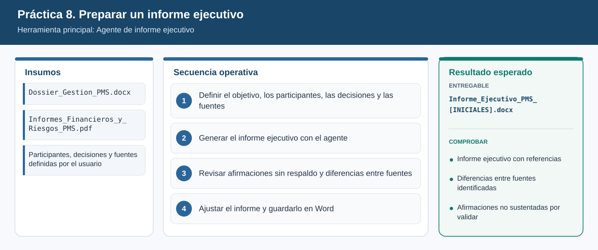
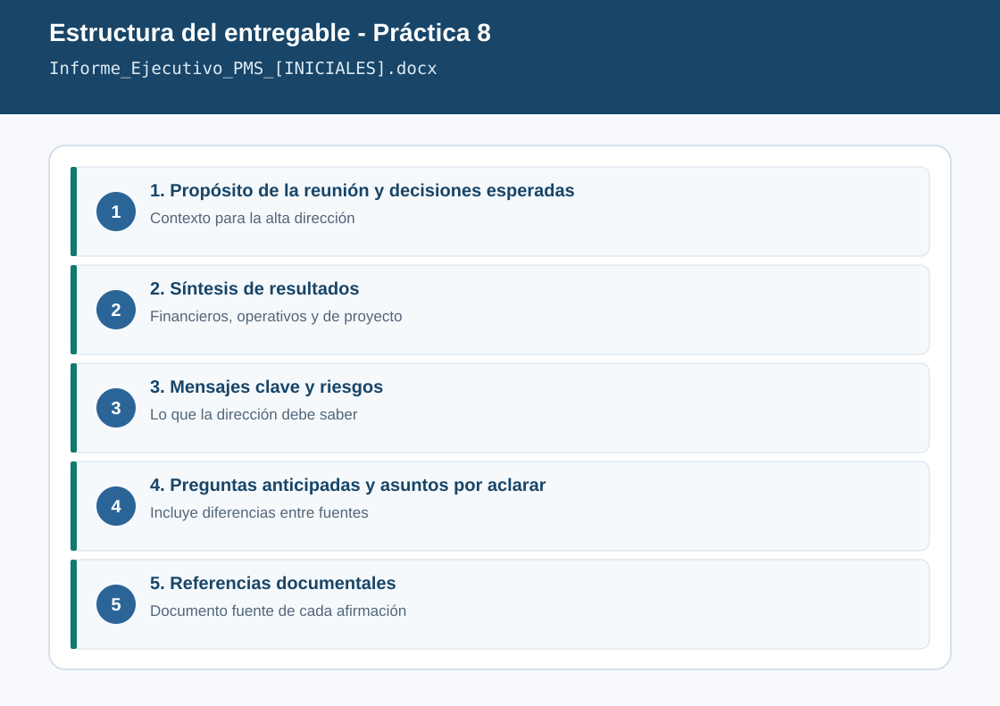

# Práctica 8. Preparar un informe ejecutivo a partir de documentación de diferentes áreas

**Capítulo 3 (Módulo 3). Inteligencia organizacional y comunicación ejecutiva**

## Objetivo de la práctica:
Al finalizar la práctica, serás capaz de:
- Utilizar el Agente de informe ejecutivo para preparar un briefing de alta dirección a partir de documentos Word y PDF de diferentes áreas.
- Definir el objetivo de la reunión, los participantes, las decisiones esperadas y las fuentes documentales que el agente debe considerar.
- Revisar críticamente el informe generado para identificar afirmaciones sin respaldo, diferencias entre fuentes y recomendaciones que deben validarse.
- Entregar un informe ejecutivo en Word con síntesis, mensajes clave, preguntas anticipadas y referencias documentales.

## Objetivo Visual


## Duración aproximada:
- 22 minutos.

| Tarea | Tiempo |
| --- | --- |
| Tarea 1. Definir el encargo del informe | 4 min |
| Tarea 2. Generar el informe ejecutivo | 7 min |
| Tarea 3. Revisar afirmaciones y diferencias entre fuentes | 7 min |
| Tarea 4. Ajustar y guardar en Word | 4 min |

## Tabla de ayuda:
| Elemento | Valor |
| --- | --- |
| Agente | Agente de informe ejecutivo |
| Documentos PDF | [Informe_Financiero_PMS_T3_2026.pdf](recursos/Informe_Financiero_PMS_T3_2026.pdf), [Evaluacion_Riesgos_PMS_2026.pdf](recursos/Evaluacion_Riesgos_PMS_2026.pdf) |
| Documentos Word | [Avance_Operativo_PMS_Oct2026.docx](recursos/Avance_Operativo_PMS_Oct2026.docx), [Resultados_Fase1_PMS.docx](recursos/Resultados_Fase1_PMS.docx), [Antecedentes_Reuniones_PMS.docx](recursos/Antecedentes_Reuniones_PMS.docx) |
| Ubicación | `Laboratorio_Copilot_ISA/Practica08/` en OneDrive |
| Reunión | Revisión de resultados del Programa de Modernización de Subestaciones (PMS) con la alta dirección |
| Nombre del entregable | `Informe_Ejecutivo_PMS_[INICIALES].docx` |

## Instrucciones

### Tarea 1. Definir el objetivo, los participantes, las decisiones y las fuentes.

Paso 1. En la aplicación Microsoft 365 Copilot, abrir **Agentes** y seleccionar **Agente de informe ejecutivo**.

Paso 2. Antes de escribir la instrucción, completar mentalmente o en una nota estos cuatro datos (se usan en el Paso 3):

| Dato | Valor para esta práctica |
| --- | --- |
| Objetivo de la reunión | Revisar los resultados del PMS y decidir el tratamiento de la solicitud de 6.800 MCOP |
| Participantes | Presidente, Vicepresidente de Transmisión, Director Financiero, Directora de Proyectos de Infraestructura |
| Decisiones esperadas | Condiciones para evaluar recursos adicionales; responsable de ciberseguridad OT; re-secuenciación |
| Fuentes | Los cinco documentos de la tabla de ayuda |

Paso 3. Escribir, referenciando los cinco documentos con `/`:

```text
Prepara un briefing ejecutivo para una reunión de alta dirección.
Objetivo: revisar los resultados del Programa de Modernización de Subestaciones (PMS) y decidir
el tratamiento de la solicitud de recursos adicionales por 6.800 MCOP.
Participantes: Presidente, Vicepresidente de Transmisión, Director Financiero y Directora de
Proyectos de Infraestructura.
Decisiones esperadas: condiciones para evaluar los recursos adicionales, responsable de la
validación de ciberseguridad OT y aprobación de la re-secuenciación de subestaciones.
Fuentes: /Informe_Financiero_PMS_T3_2026 /Evaluacion_Riesgos_PMS_2026 /Avance_Operativo_PMS_Oct2026
/Resultados_Fase1_PMS /Antecedentes_Reuniones_PMS.
Usa solo estas fuentes.
```

### Tarea 2. Generar el informe ejecutivo con el agente.

Paso 1. Si el agente solicita datos adicionales (tono, extensión, formato), responder: "Tono ejecutivo, máximo dos páginas, formato de documento".

Paso 2. Solicitar la estructura completa:

```text
El informe debe incluir: 1) propósito y decisiones esperadas, 2) síntesis de resultados financieros,
operativos y de proyecto, 3) antecedentes relevantes, 4) riesgos principales, 5) mensajes clave
para la dirección, 6) preguntas que podrían plantear los participantes, 7) asuntos que requieren
aclaración. Cada afirmación debe indicar entre corchetes el documento fuente.
```

> **Validación:** el informe incluye las siete secciones y referencias a los cinco documentos. Si falta un documento, preguntar: "¿Qué información tomaste de /Resultados_Fase1_PMS?".

### Tarea 3. Revisar afirmaciones sin respaldo y diferencias entre fuentes.

Paso 1. Escribir:

```text
Revisa tu propio informe. Lista: a) afirmaciones que no estén respaldadas textualmente por una fuente,
b) datos en los que las fuentes no coinciden (cifra o hecho, fuente 1, fuente 2),
c) recomendaciones o conclusiones que deben validarse antes de presentarse a la dirección.
```

Paso 2. Comparar el resultado con la tabla de diferencias sembradas en los documentos:

| Dato | Fuente 1 | Fuente 2 |
| --- | --- | --- |
| Ejecución del PMS | 31.200 MCOP causados (Informe financiero) | 33.900 MCOP reportados por contratistas (Avance operativo) |
| Retraso del proveedor | 14 semanas (Evaluación de riesgos) | 10 semanas (Antecedentes de reuniones) |
| Sobrecosto | 6.800 MCOP con tasa 4.350 COP/USD | Aprox. 5.900 MCOP con tasa corporativa 4.100 COP/USD (ambos en el Informe financiero) |
| Causa del retraso | Proveedor (Avance operativo) | Lección aprendida: congelar especificaciones antes de las órdenes de compra (Resultados fase 1) |

Paso 3. Abrir al menos **dos** documentos fuente y verificar manualmente una cifra de cada uno. Registrar si el agente la citó correctamente.

### Tarea 4. Ajustar el informe y guardarlo en Word.

Paso 1. Escribir:

```text
Actualiza el informe: agrega una sección "Diferencias entre fuentes" con la tabla anterior,
marca como "Por validar" las conclusiones sin respaldo y elimina cualquier recomendación de
aprobar o rechazar la solicitud. Mantén las referencias documentales.
```

Paso 2. Exportar o copiar el informe a Word (usar la opción de abrir en Word si el agente la ofrece) y guardarlo como `Laboratorio_Copilot_ISA/Entregables/Informe_Ejecutivo_PMS_[INICIALES].docx`.

### Entregable
Informe ejecutivo en Word, con síntesis de resultados, mensajes clave, preguntas anticipadas y referencias a la documentación utilizada.

Criterios de verificación:
- [ ] Define el objetivo, los participantes y las decisiones esperadas de la reunión.
- [ ] Integra información de los cinco documentos (Word y PDF) con su referencia.
- [ ] Incluye mensajes clave, preguntas anticipadas y asuntos por aclarar.
- [ ] Contiene la sección "Diferencias entre fuentes" con al menos tres diferencias.
- [ ] Marca como "Por validar" las afirmaciones sin respaldo y no recomienda aprobar ni rechazar.

### Resultado esperado


---

[⬅ Anterior: Práctica 7](../../Capitulo03/Practica07/README.md) | [Inicio](../../README.md) | [Siguiente: Práctica 9 ➡](../../Capitulo03/Practica09/README.md)
