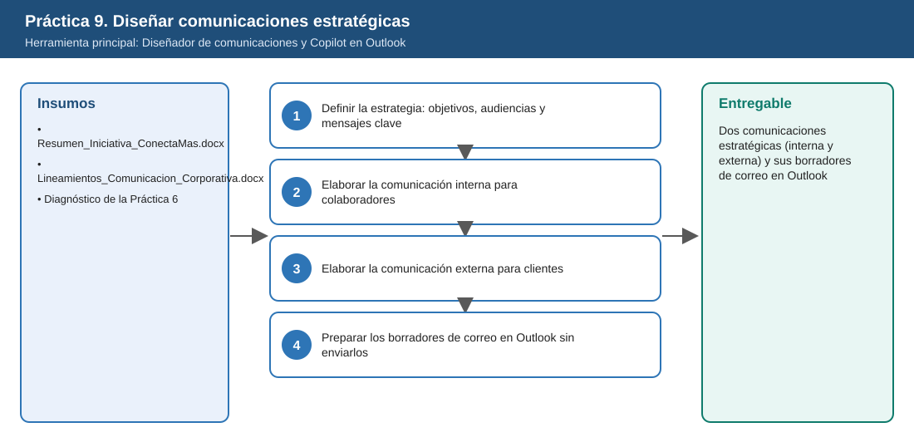
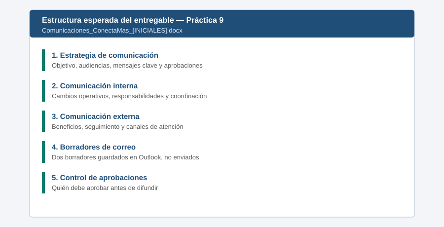

# Práctica 9. Diseñar comunicaciones estratégicas para públicos internos y externos

**Capítulo 3 (Módulo 3). Inteligencia organizacional y comunicación ejecutiva**

## Objetivo de la práctica:
Al finalizar la práctica, serás capaz de:
- Utilizar el agente Diseñador de comunicaciones para desarrollar una estrategia de comunicación de la iniciativa Conecta+.
- Elaborar una comunicación interna para colaboradores y una externa para clientes, adaptando lenguaje, nivel de detalle y mensajes clave a cada audiencia.
- Preparar en Outlook los borradores de correo que acompañarán ambas comunicaciones, considerando las autorizaciones necesarias antes de su difusión.

## Objetivo visual


## Duración aproximada:
- 22 minutos.

| Tarea | Tiempo |
| --- | --- |
| Tarea 1. Definir la estrategia de comunicación | 5 min |
| Tarea 2. Elaborar la comunicación interna | 6 min |
| Tarea 3. Elaborar la comunicación externa | 6 min |
| Tarea 4. Preparar los borradores en Outlook | 5 min |

## Tabla de ayuda:
| Elemento | Valor |
| --- | --- |
| Agente | Diseñador de comunicaciones |
| Aplicación complementaria | Outlook con Copilot (escritorio o [outlook.office.com](https://outlook.office.com/)) |
| Fuentes | [Dossier_Comunicaciones_ConectaMas.docx](recursos/Dossier_Comunicaciones_ConectaMas.docx); consultar también el entregable `Diagnostico_ConectaMas_[INICIALES].docx` de la práctica 6. |
| Fechas aprobadas | Piloto: 2 de febrero de 2027. Salida en vivo: 15 de abril de 2027 |
| Destinatarios de los borradores | Dejar el campo Para vacío o utilizar únicamente una cuenta de prueba autorizada; nunca direcciones reales de clientes |
| Nombre del entregable | `Comunicaciones_ConectaMas_[INICIALES].docx` y dos borradores no enviados en Outlook |

> **Regla de la práctica:** los correos se guardan como **borrador** y **no se envían**. La difusión requiere las aprobaciones definidas en los lineamientos.

## Instrucciones

### Tarea 1. Definir la estrategia: objetivos, audiencias y mensajes clave
**Paso 1.** Abrir en la aplicación Microsoft 365 Copilot **Agentes** y seleccionar **Diseñador de comunicaciones**.

**Paso 2.** Escribir, referenciando las fuentes con `/`:

```text
Necesito una estrategia de comunicación para la iniciativa Conecta+ de ISA INTERCOLOMBIA,
que transforma la gestión de solicitudes y atención a clientes.
Usa /Dossier_Comunicaciones_ConectaMas, la sección Lineamientos del mismo dossier y
/Diagnostico_ConectaMas_[INICIALES].
Define: objetivo de la comunicación, dos audiencias (colaboradores de las áreas involucradas y clientes),
3 mensajes clave por audiencia, canales, momento de difusión y aprobaciones necesarias.
Respeta los lineamientos: no comprometer fechas no aprobadas.
```

**Paso 3.** Verificar que la estrategia use únicamente las fechas aprobadas (febrero y abril de 2027) y que mencione las aprobaciones de Comunicaciones Corporativas, Gerencia Comercial y Jurídica para la comunicación externa.


### Tarea 2. Elaborar la comunicación interna para colaboradores
**Paso 1.** Escribir:

```text
Redacta la comunicación interna para los colaboradores de Comercial, Operación y Proyectos.
Debe explicar: los cambios operativos (portal único y número de seguimiento), las nuevas
responsabilidades (responsable por solicitud y tiempos del catálogo de servicio), los mecanismos
de coordinación (tablero compartido y revisión semanal) y la capacitación previa.
Extensión: máximo 300 palabras. Tono: claro, cercano y orientado a la acción.
```

**Paso 2.** Revisar que el texto indique qué cambia para cada colaborador y qué debe hacer, y no solo los beneficios para la empresa.

### Tarea 3. Elaborar la comunicación externa para clientes
**Paso 1.** Escribir:

```text
Redacta la comunicación para clientes. Debe informar los beneficios esperados (consulta en línea
del estado de sus solicitudes y tiempos de respuesta publicados), los nuevos mecanismos de
seguimiento y los canales de atención disponibles. Sin siglas internas, sin nombres de proyectos
internos y sin fechas que no estén aprobadas. Incluye un canal de contacto.
Extensión: máximo 200 palabras.
```

**Paso 2.** Comparar ambas comunicaciones y pedir al agente una tabla que muestre cómo se adaptaron el lenguaje, el nivel de detalle y los mensajes clave a cada audiencia.

> **Validación:** la comunicación externa no menciona "enero de 2027", "Conecta+", "CRM" ni "F2/F3". Si aparece alguno, solicitar la corrección.

### Tarea 4. Preparar los borradores de correo en Outlook sin enviarlos
**Paso 1.** Abrir Outlook y seleccionar **Nuevo correo**. Seleccionar el icono de **Copilot** y la opción **Borrador con Copilot** (o **Redactar con Copilot**).

**Paso 2.** Escribir la instrucción para el correo interno:

```text
Redacta un correo breve para los colaboradores de Comercial, Operación y Proyectos que acompañe
el comunicado adjunto sobre el nuevo modelo de gestión de solicitudes. Invita a la capacitación
y menciona a quién dirigir dudas. Tono cercano.
```

**Paso 3.** Pegar la comunicación interna en el cuerpo o adjuntar el documento, mantener **Para** vacío, escribir en el asunto el prefijo `[BORRADOR - Pendiente aprobación]` y **guardar como borrador**.

**Paso 4.** Repetir los pasos 1 a 3 para el correo a clientes con la instrucción: "Redacta un correo formal para clientes que acompañe el comunicado adjunto sobre la mejora en el seguimiento de sus solicitudes".

**Paso 5.** Consolidar la estrategia, las dos comunicaciones y la tabla de adaptación en `Laboratorio_Copilot_ISA/Entregables/Comunicaciones_ConectaMas_[INICIALES].docx`. Agregar al final una tabla de aprobaciones requeridas (comunicación, aprobador, estado: pendiente).

### Resultado esperado
Dos comunicaciones estratégicas, una interna y otra externa, acompañadas de sus respectivos borradores de correo.

**Comprobación de finalización:**
- La estrategia define objetivo, audiencias, mensajes clave, canales y aprobaciones.
- La comunicación interna explica cambios operativos, responsabilidades y mecanismos de coordinación.
- La comunicación externa explica beneficios, seguimiento y canales, sin fechas no aprobadas ni términos internos.
- Existen dos borradores en Outlook con el prefijo `[BORRADOR - Pendiente aprobación]`, sin enviar.
- El documento incluye la tabla de aprobaciones requeridas antes de la difusión.



---

[Práctica 8](../Practica08/README.md) | [Inicio](../../README.md) | [Práctica 10](../../Capitulo04/Practica10/README.md)