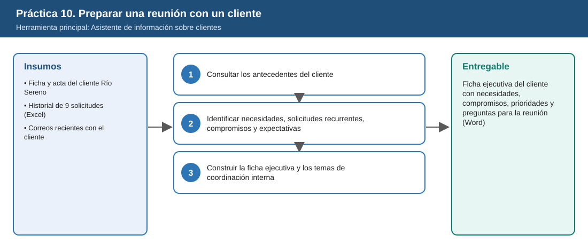
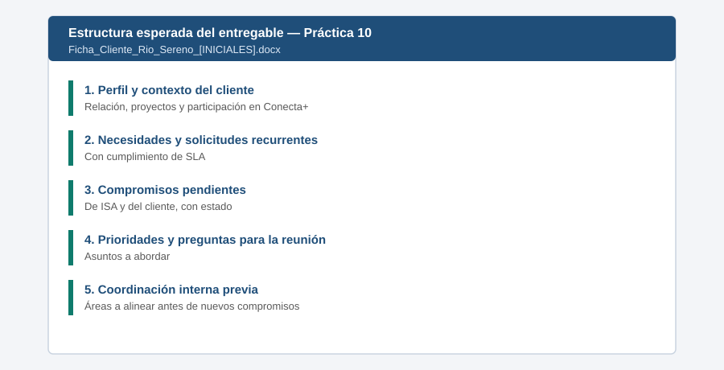

# Práctica 10. Preparación de una reunión estratégica con un cliente mediante un agente especializado

**Capítulo 4 (Módulo 4). Productividad ejecutiva y soluciones con agentes**

## Objetivo de la práctica:
Al finalizar la práctica, serás capaz de:
- Utilizar el Asistente de información sobre clientes para consultar los antecedentes de un cliente involucrado en la iniciativa Conecta+.
- Identificar necesidades, solicitudes recurrentes, compromisos pendientes y expectativas del cliente respecto a los cambios propuestos.
- Organizar una ficha ejecutiva para la reunión de seguimiento y definir los temas que requieren coordinación interna antes de establecer nuevos compromisos.

## Objetivo Visual


## Duración aproximada:
- 15 minutos.

| Tarea | Tiempo |
| --- | --- |
| Tarea 1. Consultar los antecedentes del cliente | 4 min |
| Tarea 2. Identificar necesidades, compromisos y expectativas | 5 min |
| Tarea 3. Construir la ficha ejecutiva y los temas de coordinación | 6 min |

> **Nota para el instructor:** antes de esta práctica, dedique 5 minutos (tiempo del temario) a explicar el uso especializado de agentes y cuándo conviene crear uno propio con Agent Builder. Use como hilo conductor que las prácticas 10 y 11 usan agentes existentes y la práctica 12 crea uno nuevo.

## Tabla de ayuda:
| Elemento | Valor |
| --- | --- |
| Agente | Asistente de información sobre clientes |
| Cliente (ficticio) | Generadora Río Sereno S.A. E.S.P. |
| Fuentes | [Ficha_Cliente_Generadora_Rio_Sereno.docx](recursos/Ficha_Cliente_Generadora_Rio_Sereno.docx), [Historial_Solicitudes_Rio_Sereno.xlsx](recursos/Historial_Solicitudes_Rio_Sereno.xlsx), [Correos_Cliente_Rio_Sereno.docx](recursos/Correos_Cliente_Rio_Sereno.docx), [Acta_Reunion_Cliente_2026-08-20.docx](recursos/Acta_Reunion_Cliente_2026-08-20.docx) |
| Ubicación | `Laboratorio_Copilot_ISA/Practica10/` en OneDrive |
| Fecha de corte del escenario | 6 de noviembre de 2026 |
| Nombre del entregable | `Ficha_Cliente_Rio_Sereno_[INICIALES].docx` |

> **Importante:** el entregable de esta práctica se reutiliza en la práctica 11.

## Instrucciones

### Tarea 1. Consultar los antecedentes del cliente.

Paso 1. En la aplicación Microsoft 365 Copilot, abrir **Agentes** y seleccionar **Asistente de información sobre clientes**.

Paso 2. Escribir, referenciando las fuentes con `/`:

```text
Voy a preparar una reunión de seguimiento con el cliente Generadora Río Sereno S.A. E.S.P.
Consulta sus antecedentes en /Ficha_Cliente_Generadora_Rio_Sereno /Historial_Solicitudes_Rio_Sereno
/Correos_Cliente_Rio_Sereno y /Acta_Reunion_Cliente_2026-08-20.
Resume: tipo de cliente, relación, proyectos activos, participación en la iniciativa de
transformación digital de solicitudes y últimas interacciones con fecha.
```

Paso 3. Verificar que el resumen identifique la ampliación de conexión de **120 MW** y la participación del cliente en el piloto del portal.

> **Si el agente solo consulta un sistema CRM** y no encuentra los documentos: escribir el nombre de cada archivo en la instrucción o adjuntarlos con el botón **+**. Registrar en el entregable qué fuente usó el agente.

### Tarea 2. Identificar necesidades, solicitudes recurrentes, compromisos y expectativas.

Paso 1. Escribir:

```text
Con base en las fuentes, identifica:
1) principales necesidades del cliente,
2) solicitudes recurrentes por tipo y su cumplimiento frente al tiempo de respuesta comprometido (SLA),
3) compromisos pendientes de ISA y del cliente, con fecha y estado a la fecha de corte 6-nov-2026,
4) expectativas del cliente sobre el nuevo portal y fechas que se le comunicaron.
Indica la fuente de cada dato.
```

> **Validación:** el resultado debe mostrar que los **estudios de conexión** superan el SLA (48, 41 y 79 días frente a 30), que **RS-107** y **RS-108** están vencidos, que el cliente no ha enviado completa la información de protecciones y que se le comunicó **enero de 2027** para el portal, fecha no aprobada (el piloto aprobado es el 2 de febrero de 2027).

Paso 2. Si el agente no detecta la diferencia de fecha del portal, preguntar: "¿La fecha del portal comunicada al cliente coincide con la fecha aprobada del piloto?". Indicar que la fecha aprobada está en el diagnóstico de la Práctica 6.

### Tarea 3. Construir la ficha ejecutiva y los temas de coordinación interna.

Paso 1. Escribir:

```text
Organiza la información en una ficha ejecutiva de una página para la reunión de seguimiento con:
perfil y contexto, necesidades y solicitudes recurrentes, compromisos pendientes (ISA y cliente),
asuntos prioritarios, 5 preguntas para abordar en la reunión, y temas que requieren coordinación
con otras áreas (Planeación de red, Comercial, proyecto de transformación digital) ANTES de
establecer nuevos compromisos con el cliente.
```

Paso 2. Revisar las preguntas y ajustar al menos una desde la perspectiva directiva (por ejemplo, cómo manejar la expectativa de enero sin comprometer una fecha no aprobada).

Paso 3. Copiar la ficha a Word y guardarla como `Laboratorio_Copilot_ISA/Entregables/Ficha_Cliente_Rio_Sereno_[INICIALES].docx`.

### Entregable
Ficha ejecutiva del cliente con necesidades, compromisos, prioridades y preguntas para la reunión.

Criterios de verificación:
- [ ] Incluye perfil, necesidades y solicitudes recurrentes con su cumplimiento de SLA.
- [ ] Lista compromisos pendientes de ISA y del cliente con estado a la fecha de corte.
- [ ] Identifica la diferencia entre la fecha comunicada al cliente y la fecha aprobada del piloto.
- [ ] Contiene preguntas para la reunión y temas de coordinación interna previos a nuevos compromisos.

### Resultado esperado


---

[⬅ Anterior: Práctica 9](../../Capitulo03/Practica09/README.md) | [Inicio](../../README.md) | [Siguiente: Práctica 11 ➡](../../Capitulo04/Practica11/README.md)
