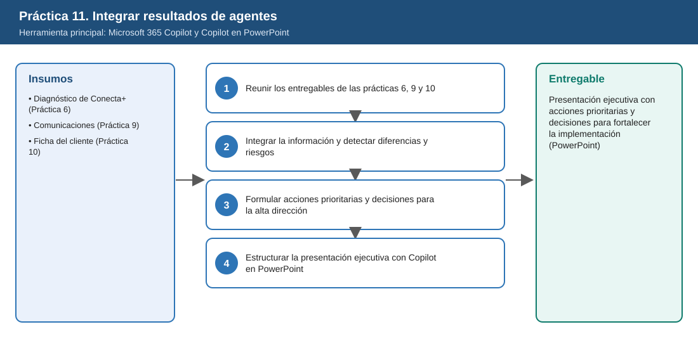
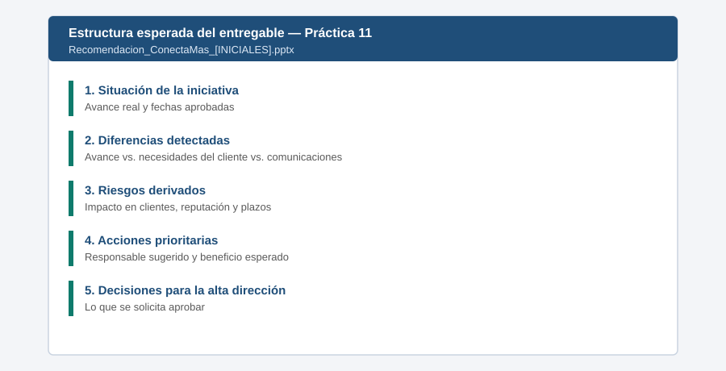

# Práctica 11. Integrar resultados de diferentes agentes para formular una recomendación directiva

**Capítulo 4 (Módulo 4). Productividad ejecutiva y soluciones con agentes**

## Objetivo de la práctica:
Al finalizar la práctica, serás capaz de:
- Integrar con Microsoft 365 Copilot los resultados de Project Delta Digest, Diseñador de comunicaciones y Asistente de información sobre clientes.
- Identificar diferencias entre los avances reportados, las necesidades del cliente y los compromisos comunicados, y los riesgos derivados.
- Proponer acciones prioritarias con responsables sugeridos, beneficios esperados y decisiones que requieren aprobación de la alta dirección.
- Estructurar con Copilot en PowerPoint una presentación ejecutiva breve que sintetice hallazgos y recomendaciones.

## Objetivo Visual


## Duración aproximada:
- 15 minutos.

| Tarea | Tiempo |
| --- | --- |
| Tarea 1. Reunir los entregables de las prácticas 6, 9 y 10 | 2 min |
| Tarea 2. Integrar la información y detectar diferencias | 5 min |
| Tarea 3. Formular acciones prioritarias y decisiones | 4 min |
| Tarea 4. Estructurar la presentación con Copilot en PowerPoint | 4 min |

## Tabla de ayuda:
| Elemento | Valor |
| --- | --- |
| Herramientas | Chat de Microsoft 365 Copilot y Copilot en PowerPoint |
| Entregables a integrar | `Diagnostico_ConectaMas_[INICIALES].docx` (Práctica 6), `Comunicaciones_ConectaMas_[INICIALES].docx` (Práctica 9), `Ficha_Cliente_Rio_Sereno_[INICIALES].docx` (Práctica 10) |
| Entregables de respaldo | [Respaldo_Diagnostico_ConectaMas.docx](recursos/Respaldo_Diagnostico_ConectaMas.docx), [Respaldo_Comunicaciones_ConectaMas.docx](recursos/Respaldo_Comunicaciones_ConectaMas.docx), [Respaldo_Ficha_Cliente_Rio_Sereno.docx](recursos/Respaldo_Ficha_Cliente_Rio_Sereno.docx) |
| Ubicación | `Laboratorio_Copilot_ISA/Entregables/` en OneDrive |
| Nombres de los entregables | `Integracion_ConectaMas_[INICIALES].docx` (insumo) y `Recomendacion_ConectaMas_[INICIALES].pptx` |

## Instrucciones

### Tarea 1. Reunir los entregables de las prácticas 6, 9 y 10.

Paso 1. Abrir OneDrive y confirmar que los tres entregables están en `Laboratorio_Copilot_ISA/Entregables/`.

Paso 2. Si falta alguno, copiar el archivo de respaldo correspondiente desde `Laboratorio_Copilot_ISA/Practica11/` y usarlo en su lugar.

### Tarea 2. Integrar la información y detectar diferencias y riesgos.

Paso 1. En la aplicación Microsoft 365 Copilot, abrir el chat de **Copilot** y escribir, referenciando los tres archivos con `/`:

```text
Integra estos tres documentos sobre la iniciativa de transformación digital de solicitudes:
/Diagnostico_ConectaMas_[INICIALES] /Comunicaciones_ConectaMas_[INICIALES] /Ficha_Cliente_Rio_Sereno_[INICIALES].
Identifica diferencias entre: a) los avances y fechas reportados por el proyecto,
b) las necesidades y expectativas del cliente, c) lo que se comunicó o se comunicará a colaboradores y clientes.
Para cada diferencia indica las fuentes que la evidencian y el riesgo derivado (clientes, reputación, plazos, costos).
```

> **Validación:** la integración debe identificar al menos: la fecha de enero de 2027 comunicada al cliente frente al piloto aprobado del 2 de febrero de 2027; la necesidad urgente del estudio RS-107 que no depende del portal; y el bloqueo de la integración con CRM por el otrosí y los datos maestros, que puede afectar lo que se promete a clientes.

### Tarea 3. Formular acciones prioritarias y decisiones para la alta dirección.

Paso 1. Escribir:

```text
Propón máximo 5 acciones prioritarias para fortalecer la implementación. Para cada una incluye:
responsable sugerido (área), beneficio esperado, plazo sugerido y si requiere aprobación de la alta
dirección. Al final, lista las decisiones concretas que se solicitan a la alta dirección.
Diferencia lo que son sugerencias de la IA de lo que está respaldado por los documentos.
```

Paso 2. Revisar las acciones como directivo: eliminar las que no sean viables y ajustar responsables si es necesario.

Paso 3. Copiar la integración, las acciones y las decisiones a un documento de Word y guardarlo como `Laboratorio_Copilot_ISA/Entregables/Integracion_ConectaMas_[INICIALES].docx`. Este documento será la fuente de la presentación.

### Tarea 4. Estructurar la presentación ejecutiva con Copilot en PowerPoint.

Paso 1. Abrir PowerPoint, crear una **Presentación en blanco** y seleccionar **Copilot** en la cinta de opciones.

Paso 2. Elegir la opción para crear una presentación a partir de un archivo y escribir:

```text
Crea una presentación ejecutiva de 6 diapositivas a partir de /Integracion_ConectaMas_[INICIALES]:
1) situación de la iniciativa, 2) diferencias detectadas, 3) riesgos derivados,
4) acciones prioritarias con responsable, 5) decisiones solicitadas a la alta dirección,
6) próximos pasos. Estilo ejecutivo, frases cortas, sin párrafos largos.
```

Paso 3. Revisar cada diapositiva: corregir cifras o fechas que no coincidan con el documento y eliminar texto excesivo.

Paso 4. Guardar como `Laboratorio_Copilot_ISA/Entregables/Recomendacion_ConectaMas_[INICIALES].pptx`.

### Entregable
Presentación ejecutiva con una propuesta de acciones prioritarias y decisiones para fortalecer la implementación de la iniciativa.

Criterios de verificación:
- [ ] Integra los resultados de las prácticas 6, 9 y 10 (o sus respaldos).
- [ ] Identifica al menos tres diferencias con sus fuentes y riesgos derivados.
- [ ] Las acciones prioritarias tienen responsable sugerido, beneficio esperado y plazo.
- [ ] La presentación contiene las decisiones solicitadas a la alta dirección.
- [ ] Las cifras y fechas de la presentación coinciden con los documentos fuente.

### Resultado esperado


---

[⬅ Anterior: Práctica 10](../../Capitulo04/Practica10/README.md) | [Inicio](../../README.md) | [Siguiente: Práctica 12 ➡](../../Capitulo04/Practica12/README.md)
