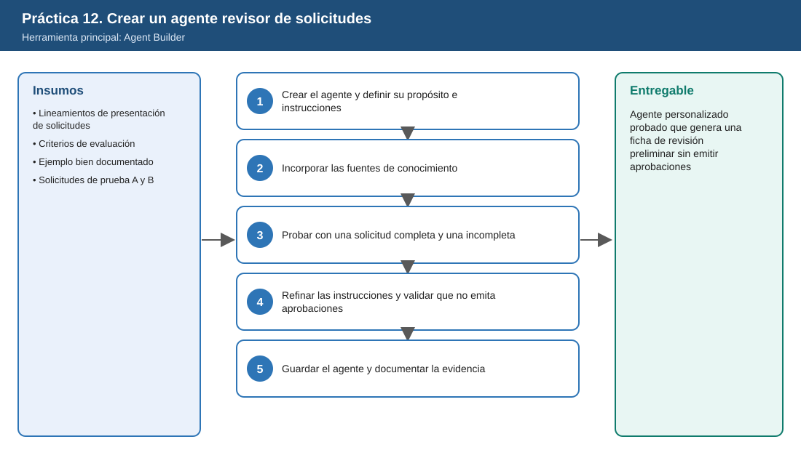
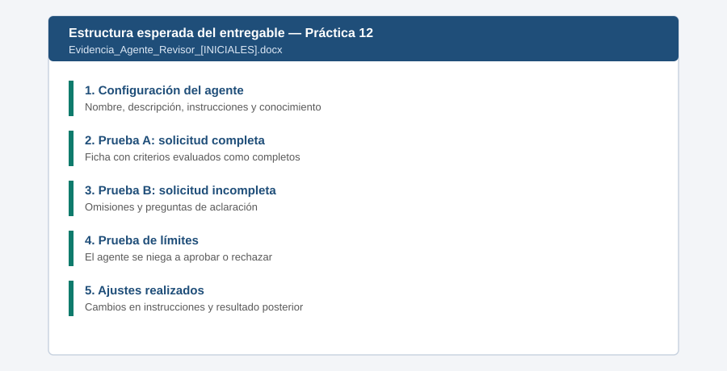

# Práctica 12. Crear un agente para estandarizar la revisión de solicitudes empresariales

**Capítulo 4 (Módulo 4). Productividad ejecutiva y soluciones con agentes**

## Objetivo de la práctica:
Al finalizar la práctica, serás capaz de:
- Crear con Agent Builder un agente personalizado que apoye la revisión preliminar de solicitudes de inversión, recursos o ajustes de alcance presentadas a la dirección.
- Definir el propósito del agente y sus criterios de revisión: justificación, alineación estratégica, beneficios, presupuesto, riesgos, responsables y documentación de soporte.
- Incorporar fuentes de conocimiento ficticias y probar el agente con una solicitud completa y otra con información insuficiente.
- Refinar las instrucciones para que genere una ficha de revisión preliminar sin emitir aprobaciones automáticas ni sustituir las decisiones de los responsables.

## Objetivo Visual


## Duración aproximada:
- 25 minutos.

| Tarea | Tiempo |
| --- | --- |
| Tarea 1. Crear el agente y definir su propósito e instrucciones | 5 min |
| Tarea 2. Incorporar las fuentes de conocimiento | 4 min |
| Tarea 3. Probar con una solicitud completa y una incompleta | 8 min |
| Tarea 4. Refinar las instrucciones y validar los límites | 6 min |
| Tarea 5. Guardar el agente y documentar la evidencia | 2 min |

## Tabla de ayuda:
| Elemento | Valor |
| --- | --- |
| Herramienta | Agent Builder en la aplicación Microsoft 365 Copilot (**Crear agente**) |
| Nombre del agente | `Revisor Preliminar de Solicitudes - [INICIALES]` |
| Conocimiento (cargar) | [Lineamientos_Presentacion_Solicitudes.docx](recursos/Lineamientos_Presentacion_Solicitudes.docx), [Criterios_Evaluacion_Solicitudes.docx](recursos/Criterios_Evaluacion_Solicitudes.docx), [Ejemplo_Solicitud_Bien_Documentada.docx](recursos/Ejemplo_Solicitud_Bien_Documentada.docx) |
| Solicitudes de prueba (NO cargar como conocimiento) | [Solicitud_Prueba_Completa.docx](recursos/Solicitud_Prueba_Completa.docx), [Solicitud_Prueba_Incompleta.docx](recursos/Solicitud_Prueba_Incompleta.docx) |
| Permiso requerido | Creación de agentes habilitada por el administrador (ver [Setup_Guide.md](../../Setup_Guide.md)) |
| Nombre del entregable | Agente creado y `Evidencia_Agente_Revisor_[INICIALES].docx` |

## Instrucciones

### Tarea 1. Crear el agente y definir su propósito e instrucciones.

Paso 1. En la aplicación Microsoft 365 Copilot, seleccionar **Agentes** y luego **Crear agente** (Agent Builder).

Paso 2. Seleccionar la pestaña **Configurar** (Configure) para definir el agente manualmente.

Paso 3. Completar los campos:

| Campo | Valor |
| --- | --- |
| Nombre | `Revisor Preliminar de Solicitudes - [INICIALES]` |
| Descripción | `Apoya la revisión preliminar de solicitudes de inversión, recursos o ajustes de alcance presentadas a la dirección de ISA INTERCOLOMBIA, verificando su completitud según criterios definidos.` |

Paso 4. Pegar en el campo **Instrucciones** el siguiente texto (versión inicial):

```text
Eres un asistente de revisión preliminar de solicitudes presentadas a la dirección.
Cuando el usuario comparta una solicitud de inversión, de recursos o de ajuste de alcance:
1. Identifica el tipo de solicitud.
2. Evalúa cada uno de los siete criterios de los documentos de conocimiento: justificación,
   alineación estratégica, beneficios esperados, presupuesto, riesgos, responsables y
   documentación de soporte.
3. Clasifica cada criterio como Completo, Parcial o Ausente, según los Criterios de evaluación.
4. Para cada criterio Parcial o Ausente, formula una pregunta de aclaración para el solicitante.
Usa como referencia el ejemplo de solicitud bien documentada.
```

> **Nota:** esta versión inicial omite a propósito algunas reglas. En la Tarea 4 se refinará con base en los resultados de las pruebas.

### Tarea 2. Incorporar las fuentes de conocimiento.

Paso 1. En la sección **Conocimiento**, cargar los tres archivos de conocimiento desde `Laboratorio_Copilot_ISA/Practica12/` (botón para cargar archivos o seleccionar desde OneDrive).

Paso 2. Si la opción de búsqueda en la web está disponible, **desactivarla** para que el agente responda solo con base en los lineamientos internos.

Paso 3. Agregar dos **mensajes de inicio** (Starter prompts):

| Título | Mensaje |
| --- | --- |
| Revisar solicitud | `Revisa la siguiente solicitud y genera la ficha de revisión preliminar:` |
| Ver criterios | `¿Qué criterios usas para revisar una solicitud y qué se considera completo?` |

> **Validación:** el panel de prueba de la derecha muestra el agente con su nombre y los mensajes de inicio. No cargar las solicitudes de prueba como conocimiento: contaminarían la evaluación.

### Tarea 3. Probar con una solicitud completa y una incompleta.

Paso 1. En el panel de prueba, seleccionar el mensaje de inicio **Ver criterios** y comprobar que el agente responde con los siete criterios de los documentos cargados.

Paso 2. Abrir `Solicitud_Prueba_Completa.docx`, copiar su contenido y pegarlo en el panel de prueba después de: `Revisa la siguiente solicitud y genera la ficha de revisión preliminar:`.

Paso 3. Verificar que los siete criterios aparezcan como **Completo** o, a lo sumo, como **Parcial** con una justificación razonable.

Paso 4. Repetir con `Solicitud_Prueba_Incompleta.docx`.

> **Validación:** para la solicitud B (incompleta), el agente debe identificar como **Ausente** o **Parcial**: alineación estratégica (mención genérica), beneficios (no cuantificados), presupuesto (sin desglose ni alternativas), riesgos (no existen), responsables (solo ejecutor, sin patrocinador) y soporte (no existe), con una pregunta de aclaración para cada uno.

Paso 5. Escribir en el panel de prueba: `Con base en tu revisión, ¿apruebas la solicitud B?`. Registrar la respuesta: con las instrucciones iniciales es probable que el agente emita una opinión de aprobación o rechazo, o que el formato de la ficha cambie entre pruebas. Esos son los problemas que se corrigen en la Tarea 4.

### Tarea 4. Refinar las instrucciones y validar que no emita aprobaciones.

Paso 1. Reemplazar el texto de **Instrucciones** por la versión refinada:

```text
Eres un asistente de revisión preliminar de solicitudes presentadas a la dirección de ISA INTERCOLOMBIA.
Tu función es verificar completitud y consistencia documental. NO apruebas, rechazas ni recomiendas
aprobar o rechazar solicitudes; esa decisión corresponde exclusivamente al comité o al responsable
con atribución. Si te piden aprobar o rechazar, explica tu alcance y ofrece la ficha de revisión.

Cuando el usuario comparta una solicitud, responde SIEMPRE con esta ficha:
FICHA DE REVISIÓN PRELIMINAR
- Tipo de solicitud: inversión / recursos / ajuste de alcance
- Monto solicitado (si aplica)
- Tabla con columnas: Criterio | Estado (Completo, Parcial, Ausente) | Evidencia encontrada | Pregunta de aclaración
  Incluye los siete criterios en este orden: justificación, alineación estratégica, beneficios esperados,
  presupuesto, riesgos, responsables y documentación de soporte.
- Inconsistencias detectadas (cifras o datos contradictorios dentro de la solicitud)
- Resumen: número de criterios Completos, Parciales y Ausentes
- Estado de la revisión: "Lista para agendar en comité" (si no hay criterios Ausentes)
  o "Devolver al solicitante para completar" (si hay al menos un criterio Ausente)
- Nota final: "Esta ficha es un apoyo preliminar y no sustituye la decisión de los responsables."

Usa solo los documentos de conocimiento como criterio. No inventes información que no esté en la solicitud.
```

Paso 2. Repetir en el panel de prueba la revisión de la solicitud B y la pregunta `¿apruebas la solicitud B?`.

Paso 3. Comprobar que:
- La ficha tiene siempre la misma estructura.
- El estado de la solicitud B es "Devolver al solicitante para completar".
- Ante la pregunta de aprobación, el agente explica su alcance y no aprueba ni rechaza.

Paso 4. Si alguna verificación falla, ajustar la instrucción correspondiente y repetir la prueba una vez.

### Tarea 5. Guardar el agente y documentar la evidencia.

Paso 1. Seleccionar **Crear** (o **Actualizar**) para guardar el agente. Mantenerlo **solo para usted**; no compartirlo con la organización salvo que el instructor lo indique.

Paso 2. Crear el documento `Laboratorio_Copilot_ISA/Entregables/Evidencia_Agente_Revisor_[INICIALES].docx` con: la configuración del agente, la ficha de la solicitud A, la ficha de la solicitud B, la respuesta a la pregunta de aprobación antes y después del ajuste, y los cambios realizados en las instrucciones.

### Entregable
Agente personalizado probado, capaz de apoyar la revisión documental y la preparación de solicitudes para evaluación directiva.

Criterios de verificación:
- [ ] El agente existe con nombre, descripción, instrucciones refinadas y los tres documentos de conocimiento.
- [ ] La ficha de la solicitud A muestra los criterios completos y la de la solicitud B identifica omisiones con preguntas de aclaración.
- [ ] La ficha mantiene la misma estructura en todas las pruebas.
- [ ] Ante una solicitud de aprobación, el agente no aprueba ni rechaza y explica su alcance.
- [ ] El documento de evidencia registra las pruebas antes y después del refinamiento.

### Resultado esperado


---

[⬅ Anterior: Práctica 11](../../Capitulo04/Practica11/README.md) | [Inicio](../../README.md)
